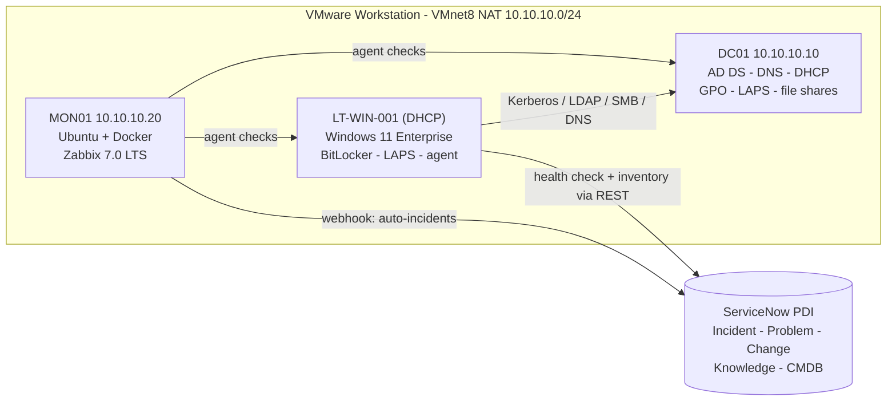

# Enterprise IT Help Desk & Endpoint Management Lab

A complete, reproducible **IT service desk and endpoint management environment** built on one laptop:
Active Directory, DNS/DHCP, Group Policy, BitLocker, Windows LAPS, Zabbix monitoring and ServiceNow ITSM,
operated with ITIL-aligned processes, a knowledge base, SOPs and PowerShell / Python / Bash automation.

The lab models **Contoso Financial** (fictional), a 50-person financial-services firm with Tier 1 Service
Desk, Tier 2 onsite Desktop Support (Windows, macOS, mobile) and three resolver groups.

> Author: **Tianle Yang** · [LinkedIn](https://www.linkedin.com/in/arthuryang2025) · Built Nov 2026 ·
> Everything here is a lab: fictional company, simulated ticket data, no real personal data.

---

## What this lab demonstrates

| Tech Operations responsibility | Where it lives in this lab |
|---|---|
| End-user support - Windows, Mac, mobile | 11 break/fix [scenarios](docs/06-lab-scenarios.md), 17 [KB articles](knowledge-base/README.md), [endpoint toolkit](scripts/powershell/endpoint), [macOS health check](scripts/bash/macos_health_check.sh) |
| Incident management & escalation | [Incident practice](itil/incident-management.md): priority matrix, SLAs, functional/hierarchical escalation; [triage SOP](sops/SOP-004-incident-triage-escalation.md); [major incident SOP](sops/SOP-005-major-incident-communications.md) + [PIR example](itil/examples/INC0010007-dhcp-scope-outage-pir.md) |
| Change management | [Change practice](itil/change-management.md), [RFC template](itil/templates/RFC-template.md), [filled GPO change](itil/examples/CHG0030001-deploy-workstation-baseline-gpo.md) with pilot, backout (`Backup-GPO`) and PIR |
| Problem management | [Problem practice](itil/problem-management.md), [RCA example](itil/examples/PRB0040001-recurring-account-lockouts.md), automated **problem-candidate detection** in [ticket_metrics.py](scripts/python/ticket_metrics.py) |
| Knowledge management | KCS-based [practice](itil/knowledge-management.md), [17 KB articles](knowledge-base/README.md), [8 SOPs](sops/README.md) |
| Endpoint management | GPO baseline, BitLocker with AD escrow, Windows LAPS, compliance checks, inventory → CMDB ([05](docs/05-endpoint-management.md)) |
| Monitoring, alerts, dashboards → escalation | Zabbix 7.0 with custom DHCP/AD triggers, webhook to ServiceNow, PowerShell health check → de-duplicated incidents ([04](docs/04-monitoring-alerting.md)) |
| Automation with PowerShell, Python, Bash | 21 PowerShell scripts/modules, 3 Python tools + an offline ServiceNow API mock, 2 Bash scripts ([tooling index](docs/01-lab-design.md#11-tooling-index)) |
| Networking fundamentals (DNS, DHCP, TCP/IP) | [Layered network triage](scripts/powershell/endpoint/Invoke-NetworkTriage.ps1); DNS, DHCP and APIPA scenarios; DC locator (SRV) and port checks |
| CMDB | Inventory sync to ServiceNow (`Sync-InventoryToCmdb.ps1`) and a [CMDB reconciliation](reports/cmdb-reconciliation.md) data-quality report |
| Business controls | [11 controls](docs/01-lab-design.md#10-business-controls-matrix): least-privilege delegation, LAPS, FGPP, USB restriction, audited offboarding, quarterly [access review](scripts/powershell/helpdesk/Get-ADAccessReview.ps1) |
| Support metrics | [Interactive KPI dashboard](reports/ticket-metrics-dashboard.html) (SLA, FCR, MTTR, backlog, CSAT) + [summary](reports/ticket-metrics-summary.md) |
| Virtualization / cloud | VMware Workstation lab; ServiceNow cloud instance; optional Intune module |

## Architecture



Full design - IP plan, OU tree, AGDLP groups, GPOs, SLAs, controls: [docs/01-lab-design.md](docs/01-lab-design.md).

## Try it in 5 minutes (any Windows PC, no lab needed)

```powershell
git clone https://github.com/arthuraetheling/Enterprise-IT-HelpDesk-Lab.git
cd Enterprise-IT-HelpDesk-Lab

# 1. Support metrics: simulated ticket data -> KPI dashboard (Python 3.9+, standard library only)
python scripts/python/generate_tickets.py
python scripts/python/ticket_metrics.py
start reports\ticket-metrics-dashboard.html

# 2. Endpoint tools on your own machine (read-only, Windows PowerShell 5.1)
.\scripts\powershell\endpoint\Get-EndpointHealth.ps1
.\scripts\powershell\endpoint\Invoke-NetworkTriage.ps1
.\scripts\powershell\endpoint\Test-EndpointCompliance.ps1

# 3. Monitoring -> ITSM integration against an offline ServiceNow mock
Start-Process python 'tests/mock_servicenow.py'
$cred = New-Object PSCredential('svc.helpdesk.automation', (ConvertTo-SecureString 'lab-only' -AsPlainText -Force))
.\scripts\powershell\integration\Invoke-HealthCheckAndAlert.ps1 -InstanceUrl http://127.0.0.1:8765 -Credential $cred
```

To build the full environment, follow [docs/02-build-guide.md](docs/02-build-guide.md) (about 8-10 hours).

## Break/fix scenarios

`Invoke-LabFault.ps1` injects realistic faults and prints only the user's complaint; the
[answer key](docs/06-lab-scenarios.md) explains triage, root cause, fix and ITIL follow-up.

| Identity | Network | Endpoint | Infrastructure |
|---|---|---|---|
| Account lockout (event 4740 source) | DNS misconfiguration | Low disk / slow laptop | DHCP scope deactivated (major incident) |
| Share access removed (AGDLP, Kerberos token) | Clock skew (Kerberos 0x25) | Print queue stuck | DHCP service down (monitoring-detected) |
| Broken domain trust (LAPS + secure channel) | | BitLocker recovery (key from AD, rotate) | GPO not applying (wrong OU) |

## Results from the simulated dataset

504 simulated tickets over 90 days ([summary](reports/ticket-metrics-summary.md)):
**92.2%** resolution SLA (P2 only 71.4%), **61.4%** first-contact resolution (target 70%), **4.8 h** median
time to resolve, **95.7%** response SLA. The detector found **4 problem candidates** - exactly the four
patterns seeded into the data, with no false positives - and 10 rule-based recommendations,
for example self-service password reset to deflect about 17 tickets a month.

<!-- Add your own screenshots after building the lab (see docs/screenshots/README.md):


-->

## Repository layout

```
docs/                 design, build guide, ServiceNow, monitoring, endpoint management, scenarios, metrics
itil/                 incident / problem / change / knowledge practices, templates, filled example records
knowledge-base/       KB0001-KB0017 (Windows, AD, network, BitLocker, printing, Microsoft 365, macOS, mobile)
sops/                 SOP-001-SOP-008 (onboarding, offboarding, provisioning, triage, major incident, lost device, alerts, access review)
scripts/powershell/   lab-build (01-05), helpdesk tools, endpoint tools, ServiceNow integration, fault injection
scripts/python/       generate_tickets.py, ticket_metrics.py, cmdb_reconcile.py
scripts/bash/         macos_health_check.sh, linux_health_check.sh
infrastructure/       Zabbix docker-compose and agent configuration
data/                 lab users, sample new hires, simulated tickets, CMDB export, sample inventory
reports/              generated dashboard and reports (simulated data)
tests/                mock_servicenow.py - offline ServiceNow Table API for testing the integrations
```

## Engineering notes

- PowerShell targets **Windows PowerShell 5.1** (in-box on Windows Server and Windows 11); every state-changing
  script supports `-WhatIf`; configuration lives in one file (`scripts/powershell/Lab.Config.psd1`).
- Help desk scripts write an **audit trail without secrets**; temporary passwords are shown once and never logged.
- Fault injection **refuses to run** outside the lab domain.
- Python tools use the **standard library only** and accept real ServiceNow CSV exports.
- Tested here: PowerShell parses cleanly (22 files); the endpoint tools ran on a real Windows 11 laptop; the
  ServiceNow integration was verified against the mock (create → de-duplicate → auto-resolve, CMDB upsert,
  401 handling); the dashboard was checked in light and dark mode and at phone width.
- Not runnable without the lab: domain build scripts (need a Windows Server VM) and Bash scripts
  (need macOS / Ubuntu).

## License

MIT - see [LICENSE](LICENSE). Contoso is a fictional company used in Microsoft documentation-style examples.
