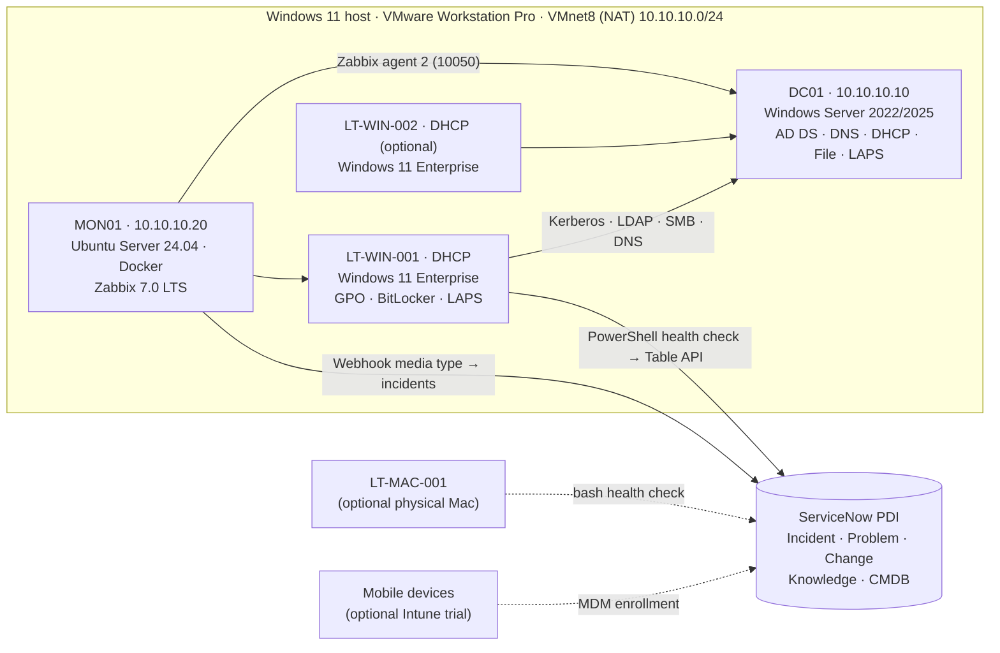

# 01 · Lab Design & Conventions

This document is the single source of truth for the lab: names, addresses, groups, policies, SLAs and
tooling. Every script, KB article, SOP and ITIL document in this repository follows these conventions.

---

## 1. Business scenario

**Contoso Financial** (fictional) is a 50-person financial-services firm with five departments.
The IT team runs a Tier 1 Service Desk, Tier 2 Desktop Support (onsite laptop support for Windows,
macOS and mobile) and three resolver groups. The lab recreates that environment end to end:
identity, endpoints, network services, monitoring, ITSM (incident/problem/change/knowledge/CMDB)
and business controls.

| Department | Users | Manager (persona) | Notes |
|---|---|---|---|
| Finance | 10 | Olivia Bennett | USB storage blocked by policy (data-loss control) |
| HR | 10 | Hannah Brooks | Handles PII; strict share permissions |
| IT | 10 | Lucas Moreno | Help desk staff use separate privileged accounts |
| Sales | 10 | Marcus Reed | Highly mobile; VPN + mobile email heavy |
| Operations | 10 | Daniel Kim | Shared printers, shift workers |

---

## 2. Topology



### Virtual machines

| VM | OS | vCPU | RAM (16 GB host) | RAM (32 GB host) | Disk (thin) | Role |
|---|---|---|---|---|---|---|
| DC01 | Windows Server 2022 or 2025 Standard **Evaluation** (Desktop Experience) | 2 | 3 GB | 4 GB | 60 GB | AD DS, DNS, DHCP, file shares, Windows LAPS, BitLocker key escrow |
| LT-WIN-001 | Windows 11 Enterprise **Evaluation** | 2 | 4 GB | 6 GB | 64 GB + vTPM | Primary end-user laptop (persona: Emma Carter, Finance) |
| MON01 | Ubuntu Server 24.04 LTS | 2 | 2 GB | 4 GB | 30 GB | Docker + Zabbix 7.0 LTS (server, web, PostgreSQL) |
| LT-WIN-002 *(optional)* | Windows 11 Enterprise Evaluation | 2 | 3 GB (power off MON01) | 4 GB | 64 GB + vTPM | Second user (Marcus Reed, Sales) / technician workstation with RSAT |

All evaluation media are free from the Microsoft Evaluation Center (Server: 180 days, Windows 11
Enterprise: 90 days). Take a VMware snapshot after every build milestone; snapshots double as the
**backout plan** for lab change records.

---

## 3. Network & IP plan

VMware **VMnet8 (NAT)** is re-addressed to `10.10.10.0/24` and VMware's built-in DHCP is **disabled**
so that DC01 is the only DHCP server (exactly like an enterprise LAN).

| Address / range | Assigned to | Notes |
|---|---|---|
| 10.10.10.2 | VMware NAT gateway + DNS proxy | Default gateway for every VM; DNS forwarder for DC01 |
| 10.10.10.10 | DC01 | Static. DNS for the whole lab |
| 10.10.10.20 | MON01 | Static (netplan). DNS A record `mon01`, CNAME `zabbix` |
| 10.10.10.100 – 10.10.10.200 | DHCP scope `CORP-CLIENTS` | Lease 8 days; options 003 = 10.10.10.2, 006 = 10.10.10.10, 015 = corp.contoso.internal |
| 10.10.10.250 | (unused on purpose) | "Dead" printer IP used by the `SpoolerStuck` scenario |

| DNS item | Value |
|---|---|
| AD domain (FQDN) | `corp.contoso.internal` |
| NetBIOS name | `CONTOSO` |
| Distinguished name | `DC=corp,DC=contoso,DC=internal` |
| Forward zone | `corp.contoso.internal` (AD-integrated, secure dynamic updates) |
| Reverse zone | `10.10.10.in-addr.arpa` (AD-integrated) |
| Forwarders | `10.10.10.2` (VMware NAT), `1.1.1.1` |
| Time source | DC01 (PDC emulator) ← `time.windows.com`, `pool.ntp.org`; clients use domain hierarchy |

> **Why `.internal`?** ICANN reserved `.internal` for private use in 2024. Avoiding `.local` prevents
> conflicts with multicast DNS (Bonjour) on macOS and iOS clients.

---

## 4. Active Directory design

### 4.1 OU structure

```
corp.contoso.internal
├── Domain Controllers                 (default — DC01)
└── Contoso
    ├── Users
    │   ├── Finance      ├── HR      ├── IT      ├── Sales      └── Operations
    ├── Admins                         (privileged accounts: adm.tech, hd.tier1, hd.tier2)
    ├── Groups                         (all security groups)
    ├── ServiceAccounts                (svc-scanner)
    ├── Computers
    │   ├── Workstations               (redircmp target — new domain joins land here; baseline GPOs)
    │   ├── Servers
    │   └── Staging                    (no baseline GPOs — used by the WrongOU scenario)
    └── Disabled                       (offboarded users and retired computers)
```

### 4.2 Accounts & naming

| Type | Convention | Example | Notes |
|---|---|---|---|
| Standard user | `first.last` (sAMAccountName ≤ 20 chars) | `emma.carter` | UPN `emma.carter@corp.contoso.internal` |
| Tier 1 help desk | `hd.tier1` | — | Member of `GG-HelpDesk-Tier1` |
| Tier 2 desktop support | `hd.tier2` | — | Member of `GG-HelpDesk-Tier2` (nested in Tier 1) |
| Domain admin (Tier 0) | `adm.tech` | — | Never used for daily work or end-user logons |
| Service account | `svc-<purpose>` | `svc-scanner` | Password-never-expires **exception** (flagged by access review) |
| Control-test seed | `legacy.contractor` | — | Expired account left enabled on purpose; the access review must detect it |
| Windows laptop | `LT-WIN-###` | `LT-WIN-001` | |
| Mac laptop | `LT-MAC-###` | `LT-MAC-001` | Not AD-bound (modern Mac management) |
| Mobile device | `MB-IOS-###` / `MB-AND-###` | `MB-IOS-001` | CMDB only (MDM-managed) |
| Server | `<ROLE>##` | `DC01`, `MON01` | |

### 4.3 Groups (AGDLP)

Accounts → **G**lobal groups (role/department) → **D**omain **L**ocal groups (resource permission) → **P**ermissions.

| Group | Scope | Members | Purpose |
|---|---|---|---|
| `GG-Finance`, `GG-HR`, `GG-IT`, `GG-Sales`, `GG-Operations` | Global | Department users | Role membership |
| `GG-AllStaff` | Global | Every standard user | FGPP target, read access to share root |
| `GG-Managers` | Global | Department managers | Approvers for access requests |
| `GG-HelpDesk-Tier1` | Global | `hd.tier1`, `GG-HelpDesk-Tier2` | Delegated password reset + unlock on `OU=Users` |
| `GG-HelpDesk-Tier2` | Global | `hd.tier2` | Tier 1 rights + LAPS read/reset + BitLocker recovery read on `OU=Workstations` |
| `DL-FS-<Dept>-RW` (5 groups) | Domain local | `GG-<Dept>` | Modify on `\\DC01\Departments\<Dept>` |

### 4.4 Password & lockout policy (Fine-Grained Password Policies)

| PSO | Precedence | Applies to | Min length | Max age | History | Lockout |
|---|---|---|---|---|---|---|
| `PSO-Privileged-Admins` | 10 | `Domain Admins`, `GG-HelpDesk-Tier1`, `GG-HelpDesk-Tier2` | 15 | 60 days | 24 | 3 attempts / 30 min |
| `PSO-Standard-Users` | 20 | `GG-AllStaff` | 12 | 90 days | 24 | 5 attempts / 15 min (observation 15 min) |

### 4.5 Delegation (least privilege)

| Group | Scope (OU) | Rights |
|---|---|---|
| `GG-HelpDesk-Tier1` | `OU=Users,OU=Contoso` (user objects) | Reset Password, read/write `lockoutTime`, read/write `pwdLastSet` |
| `GG-HelpDesk-Tier2` | `OU=Workstations` | Windows LAPS password read + reset, read BitLocker recovery information |
| `adm.tech` (Domain Admins) | Domain | Everything else (domain joins, GPO edits, schema) — used only under a change record |

### 4.6 Windows LAPS

- Schema extended with `Update-LapsADSchema`; computers in `OU=Workstations` may update their own password.
- Policy (GPO `CON-C-Workstation-LAPS`): back up to **Active Directory**, 30-day age, length 14, complexity 4.
- Retrieval: `Get-LapsADPassword -Identity LT-WIN-001 -AsPlainText` (Tier 2 only). Every retrieval is
  logged in the ticket; the password rotates automatically after use (post-authentication action).

---

## 5. Group Policy design

| GPO | Linked to | Key settings | Control objective |
|---|---|---|---|
| `CON-C-Workstation-Baseline` | `OU=Workstations` | Windows Firewall on (Domain/Private/Public); machine inactivity lock 900 s; logon banner ("Authorized use only"); Windows Update auto-install 03:00; Defender real-time protection enforced; PowerShell script-block logging | Endpoint hardening, monitoring evidence |
| `CON-C-Workstation-BitLocker` | `OU=Workstations` | XTS-AES 256 for OS drive; recovery password **must** be escrowed to AD DS before encryption | Data-at-rest protection, recoverability |
| `CON-C-Workstation-LAPS` | `OU=Workstations` | Windows LAPS → AD, 30 days, 14 chars, complexity 4 | Unique local admin passwords |
| `CON-U-Standard-User` | `OU=Users,OU=Contoso` | Password-protected screen saver after 900 s; **S:** drive → `\\DC01\Departments` (Group Policy Preferences, created in GPMC) | Consistent user experience |
| `CON-U-Finance-USB-Deny` | `OU=Finance,OU=Users,OU=Contoso` | Deny all removable storage classes | Data-loss prevention for financial data |

Home drive **H:** is not a GPO — it comes from the user's `homeDirectory`/`homeDrive` attributes
(`\\DC01\Home$\<sAMAccountName>`), which `New-Employee.ps1` sets.

---

## 6. File services (DC01 — acceptable in a lab, not in production)

| Share | Path | Share permissions | NTFS | Extras |
|---|---|---|---|---|
| `Departments` | `C:\Shares\Departments` | Authenticated Users: Change | Root: `GG-AllStaff` read (this folder only); `<Dept>` subfolder: `DL-FS-<Dept>-RW` Modify | Access-based enumeration (users only see folders they can open) |
| `Home$` (hidden) | `C:\Shares\Home` | Authenticated Users: Change | Root: traverse only; `<user>` folder: that user Modify | Created per user by `New-Employee.ps1` |

---

## 7. Endpoint fleet & CMDB

| CI name | Class (ServiceNow) | Platform | Assigned to | Management |
|---|---|---|---|---|
| DC01 | `cmdb_ci_win_server` | Windows Server | IT – Infrastructure Ops | AD, Zabbix |
| MON01 | `cmdb_ci_linux_server` | Ubuntu 24.04 | IT – Infrastructure Ops | Zabbix (self) |
| LT-WIN-001 | `cmdb_ci_computer` | Windows 11 | emma.carter (Finance) | GPO, BitLocker, LAPS, Zabbix agent, PowerShell health checks |
| LT-WIN-002 | `cmdb_ci_computer` | Windows 11 | marcus.reed (Sales) | Same as above |
| LT-MAC-001 | `cmdb_ci_computer` | macOS | priya.shah (HR) | MDM (concept), `macos_health_check.sh` |
| MB-IOS-001 | `cmdb_ci_comm` *(or Mobile Device class if installed)* | iOS | olivia.bennett (Finance) | MDM / Intune (optional) |
| MB-AND-001 | `cmdb_ci_comm` | Android | daniel.kim (Operations) | MDM / Intune (optional) |

Inventory flows: `Get-EndpointInventory.ps1` (JSON) → `Sync-InventoryToCmdb.ps1` (ServiceNow Table API)
and `cmdb_reconcile.py` (data-quality report: unregistered, stale, drifted and duplicate CIs).

---

## 8. ITSM design (ServiceNow Personal Developer Instance)

### 8.1 Assignment groups (escalation path)

| Group | Tier | Owns |
|---|---|---|
| **Contoso Service Desk** | Tier 1 | All intake (phone, email, portal, chat, walk-up), password resets/unlocks, MFA resets, how-to, KB-based fixes. Target FCR ≥ 70% |
| **Contoso Desktop Support** | Tier 2 (onsite) | Laptop hardware, OS repair/reimage, BitLocker recovery, LAPS, printers, macOS, mobile devices, endpoint monitoring alerts |
| **Contoso Identity & Access** | Tier 3 | AD accounts/groups, onboarding/offboarding, privileged access, access reviews |
| **Contoso Network Operations** | Tier 3 | DNS, DHCP, VPN, Wi-Fi, firewall, connectivity |
| **Contoso Infrastructure Ops** | Tier 3 | Servers (DC01, MON01), AD DS health, file services, monitoring platform, server alerts |

**Functional escalation:** Tier 1 escalates after **20 minutes** without progress, or immediately when the
fix needs physical access, elevated rights, or an infrastructure change.
**Hierarchical escalation:** P1 → Major Incident Manager immediately; any ticket at 75% of its SLA →
team lead notified; P2 with no progress in 1 hour → team lead.

### 8.2 Categories (incident `category` / `subcategory`)

| Category (label → value) | Subcategories used in this lab |
|---|---|
| Account & Access → `account` *(custom)* | password reset, account lockout, MFA, access request |
| Hardware → `hardware` | laptop, battery/power, dock/monitor, peripherals, disk, BitLocker |
| Software → `software` | OS, Microsoft 365 apps, application install, Windows Update |
| Network → `network` | dns, dhcp, vpn, wireless, file share |
| Email & Collaboration → `email` *(custom)* | Outlook, mailbox, Teams |
| Mobile Device → `mobile` *(custom)* | enrollment, email on device, lost/stolen |
| Printing → `printing` *(custom)* | print queue, printer mapping |
| Security → `security` *(custom)* | phishing report, malware alert, suspicious sign-in |

(`hardware`, `software`, `network`, `inquiry`, `database` exist out of the box; the custom values are
added in the PDI as part of the ITSM setup guide.)

### 8.3 Priority matrix (Impact × Urgency — ServiceNow default lookup)

| Impact ↓ / Urgency → | 1 – High | 2 – Medium | 3 – Low |
|---|---|---|---|
| **1 – High** (enterprise, a critical service, many users) | **P1 Critical** | P2 High | P3 Moderate |
| **2 – Medium** (a department/group, or a VIP) | P2 High | P3 Moderate | P4 Low |
| **3 – Low** (a single user) | P3 Moderate | P4 Low | P5 Planning |

### 8.4 SLA targets (calendar hours in the lab)

| Priority | Response (acknowledge) | Resolution | Customer update cadence |
|---|---|---|---|
| P1 Critical | 15 min | 4 h | Every 30 min |
| P2 High | 30 min | 8 h | Every 2 h |
| P3 Moderate | 2 h | 24 h | Daily |
| P4 Low | 8 h | 72 h | Every 2 days |
| P5 Planning | 24 h | 120 h | Weekly |

### 8.5 KPI targets (tracked by `ticket_metrics.py`)

| KPI | Definition | Target |
|---|---|---|
| First Contact Resolution (FCR) | Tier 1 incidents resolved on first contact without escalation | ≥ 70% |
| SLA attainment (resolution) | Resolved within the target for its priority | ≥ 95% P1/P2, ≥ 90% overall |
| SLA attainment (response) | Acknowledged within the response target | ≥ 95% |
| MTTA / MTTR | Mean/median time to acknowledge / resolve, by priority | Trending down |
| Reopen rate | Resolved tickets reopened by the caller | ≤ 5% |
| Reassignment rate | Tickets with ≥ 2 reassignments ("ping-pong") | ≤ 10% |
| Backlog aging | Open tickets older than 14 days | ≤ 5% of backlog |
| CSAT | Post-resolution survey (1–5) | ≥ 4.5 |

### 8.6 Record numbering (ServiceNow style)

| Record | Format | First number used in docs |
|---|---|---|
| Incident | `INC00#####` | INC0010001 |
| Requested item | `RITM00#####` | RITM0010001 |
| Problem | `PRB00#####` | PRB0040001 |
| Change | `CHG00#####` | CHG0030001 |
| Knowledge article | `KB####` (repo) | KB0001 |
| SOP | `SOP-###` | SOP-001 |

---

## 9. Monitoring & alerting design

| Source | Checks | Warning | Critical |
|---|---|---|---|
| Zabbix agent 2 on DC01, LT-WIN-001 (template *Windows by Zabbix agent active*) | CPU, memory, disk, services, uptime, ICMP | Defaults of the template | Defaults of the template |
| Zabbix on DC01 (custom items) | DNS (TCP 53), LDAP (389), Kerberos (88), SMB (445), DHCPServer service | — | Service down / port closed |
| `Get-EndpointHealth.ps1` (scheduled task on endpoints) | Free space per fixed volume (percent **and** an absolute floor, so large disks do not false-alarm) | < 15% and < 25 GB | < 10% and < 10 GB |
| | Memory in use | > 85% | > 95% |
| | Uptime (pending patches) | > 14 days | > 30 days |
| | Pending reboot | Yes | — |
| | Defender real-time protection / signature age | Signatures > 3 days | RTP off |
| | Firewall profiles | — | Any profile off |
| | Automatic services stopped (filtered) | ≥ 1 | — |
| | System log critical/error events (24 h) | ≥ 1 critical or ≥ 10 errors | — |

**Alert → incident mapping**

| Source severity | Impact | Urgency | Resulting priority | Assignment group |
|---|---|---|---|---|
| Zabbix *Disaster* (server) | 1 | 1 | P1 | Contoso Infrastructure Ops |
| Zabbix *High* (server) | 2 | 1 | P2 | Contoso Infrastructure Ops |
| Zabbix *Average* (server) | 2 | 2 | P3 | Contoso Infrastructure Ops |
| Zabbix *Warning* (any) | 3 | 2 | P4 | Owning group |
| Endpoint health *Critical* | 3 | 1 | P3 | Contoso Desktop Support |
| Endpoint health *Warning* | 3 | 2 | P4 | Contoso Desktop Support |

De-duplication: every automated incident carries `correlation_id = <HOST>-<CHECK>`; while an incident with
that correlation ID is open, new alerts add a work note instead of creating a duplicate.

---

## 10. Business controls matrix

| # | Control | Implementation in the lab | Evidence produced |
|---|---|---|---|
| BC-01 | Least privilege for support staff | Delegated Tier 1/Tier 2 rights (§4.5); separate admin accounts | `dsacls` output, group membership export |
| BC-02 | Unique local admin passwords | Windows LAPS | `Get-LapsADPassword` audit in ticket notes |
| BC-03 | Data-at-rest encryption | BitLocker XTS-AES 256 with AD escrow | `Test-EndpointCompliance.ps1` report |
| BC-04 | Password & lockout standards | FGPP (§4.4) | `Get-ADFineGrainedPasswordPolicy` output |
| BC-05 | Timely deprovisioning | `Remove-Employee.ps1` (disable, strip groups, move, stamp ticket) — target **same business day** | Offboarding CSV log with ticket number |
| BC-06 | Periodic access review | `Get-ADAccessReview.ps1` quarterly; manager attestation | HTML/CSV report + sign-off in RITM |
| BC-07 | Change control | Normal/standard/emergency changes recorded before GPO/DNS/DHCP edits | CHG records, snapshots as backout |
| BC-08 | Removable media restriction | `CON-U-Finance-USB-Deny` | GPO report (`Get-GPOReport`) |
| BC-09 | Endpoint security baseline | `CON-C-Workstation-Baseline` + compliance script | Compliance CSV per device |
| BC-10 | Logging & monitoring | Zabbix, script-block logging, health checks → incidents | Zabbix problem history, incident records |
| BC-11 | Asset/CMDB accuracy | Inventory sync + `cmdb_reconcile.py` | Reconciliation report |

---

## 11. Tooling index

All PowerShell targets **Windows PowerShell 5.1** (in-box on Windows Server and Windows 11). Every
script that changes state supports `-WhatIf`. Lab build/helpdesk scripts read
`scripts/powershell/Lab.Config.psd1`, so the domain name, IPs and OUs live in one place.

### Lab build — run on DC01 in order

| Script | What it does |
|---|---|
| `lab-build/01-Install-DomainController.ps1` | Static IP 10.10.10.10, rename to DC01, install AD DS, create forest `corp.contoso.internal` (prompts for DSRM password; run → reboot → run again) |
| `lab-build/02-Configure-DnsDhcp.ps1` | Reverse zone, forwarders, `mon01`/`zabbix` records, DHCP role + authorization + scope + options, NTP source |
| `lab-build/03-Build-ADStructure.ps1` | OUs, groups, admin/service/seed accounts, FGPPs, Tier 1/2 delegation, Windows LAPS, `redircmp`, file shares |
| `lab-build/04-Import-LabUsers.ps1` | Creates the 50 users from `data/users.csv` (prompts for the initial password) |
| `lab-build/05-Configure-GroupPolicy.ps1` | Creates and links the five GPOs in §5 |

### Help desk tools — run on DC01 or an RSAT workstation

| Script | Example |
|---|---|
| `helpdesk/New-Employee.ps1` | `.\New-Employee.ps1 -FirstName Ava -LastName Turner -Department Sales -Title "Account Executive" -Manager marcus.reed -TicketNumber RITM0010001` (or `-CsvPath`) — creates the account, groups, home folder, temp password, ticket note |
| `helpdesk/Remove-Employee.ps1` | `.\Remove-Employee.ps1 -SamAccountName ava.turner -TicketNumber RITM0010002` — disables, scrambles password, exports + removes groups, moves to `OU=Disabled`, stamps description |
| `helpdesk/Get-AccountLockoutInfo.ps1` | `.\Get-AccountLockoutInfo.ps1 -SamAccountName emma.carter [-Unlock]` — lockout state per DC, bad-password count, **lockout source computer** (event 4740 on the PDC emulator) |
| `helpdesk/Reset-UserPassword.ps1` | `.\Reset-UserPassword.ps1 -SamAccountName emma.carter -TicketNumber INC0010001 -VerificationMethod "Manager callback"` — temp password, unlock, must-change-at-logon, audit line |
| `helpdesk/Get-BitLockerRecoveryKey.ps1` | `.\Get-BitLockerRecoveryKey.ps1 -ComputerName LT-WIN-001 [-KeyId 1A2B3C4D]` |
| `helpdesk/Get-ADAccessReview.ps1` | `.\Get-ADAccessReview.ps1 [-InactiveDays 90]` — stale, never-expiring, expired-but-enabled, disabled-with-groups, privileged membership → HTML + CSV |

### Endpoint tools — run on any Windows 10/11 device (admin recommended, not required)

| Script | Example |
|---|---|
| `endpoint/Get-EndpointHealth.ps1` | `.\Get-EndpointHealth.ps1 [-Format Console|Json|Html] [-OutputPath <dir>]` — exit code 0 OK / 1 Warning / 2 Critical |
| `endpoint/Invoke-NetworkTriage.ps1` | `.\Invoke-NetworkTriage.ps1 [-InternalHost dc01.corp.contoso.internal]` — layered check: adapter → IP/APIPA → gateway → DNS → ports → verdict |
| `endpoint/Invoke-EndpointRemediation.ps1` | `.\Invoke-EndpointRemediation.ps1 -Action FlushDns|RenewDhcp|ClearTemp|DiskCleanup|RestartSpooler|ResetWindowsUpdate|GpUpdate|RepairSecureChannel|SyncTime|ResetNetworkStack [-WhatIf]` |
| `endpoint/Test-EndpointCompliance.ps1` | `.\Test-EndpointCompliance.ps1 [-MinimumBuild 26100]` — BitLocker, Defender, firewall, OS build, patch age, screen lock, local admins, LAPS |
| `endpoint/Get-EndpointInventory.ps1` | `.\Get-EndpointInventory.ps1 [-OutputPath <dir>]` — hardware, OS, network, software → JSON for the CMDB |

### Integration

| Script | Example |
|---|---|
| `integration/ServiceNow.psm1` | Module: `Connect-ServiceNow`, `New-SnIncident`, `Find-SnOpenIncident`, `Add-SnWorkNote`, `Resolve-SnIncident`, `Set-SnComputerCi` (Table API, reference lookups, `-DryRun`) |
| `integration/Invoke-HealthCheckAndAlert.ps1` | `.\Invoke-HealthCheckAndAlert.ps1 -InstanceUrl https://devNNNNN.service-now.com -Credential (Get-Credential) [-AutoResolve] [-DryRun]` |
| `integration/Sync-InventoryToCmdb.ps1` | `.\Sync-InventoryToCmdb.ps1 -InventoryPath .\LT-WIN-001.json -InstanceUrl ... -Credential ...` |
| `tests/mock_servicenow.py` | `python tests/mock_servicenow.py` — offline mock of the Table API on `http://127.0.0.1:8765` |

### Fault injection (training scenarios — refuses to run outside `corp.contoso.internal`)

`lab-faults/Invoke-LabFault.ps1 -Scenario <name> [-Revert] [-UserName emma.carter] [-ComputerName LT-WIN-001]` · `-List`

| Scenario | Run on | What breaks |
|---|---|---|
| `AccountLockout` | LT-WIN-001 | Repeated bad passwords for `-UserName` from this laptop |
| `DnsMisconfig` | LT-WIN-001 | Adapter DNS set to a public resolver — internet works, internal names fail |
| `DhcpScopeDown` | DC01 | Scope `CORP-CLIENTS` deactivated → clients fall back to APIPA |
| `DhcpServiceDown` | DC01 | DHCP Server service stopped (monitoring/alert scenario) |
| `ShareAccessRemoved` | DC01 | `-UserName` removed from their department group → "Access denied" |
| `WrongOU` | DC01 | `-ComputerName` moved to `OU=Staging` → baseline GPOs stop applying |
| `BrokenTrust` | DC01 | Computer account password reset → "trust relationship failed" |
| `ClockSkew` | LT-WIN-001 | Time service stopped, clock +10 min → Kerberos failures |
| `SpoolerStuck` | LT-WIN-001 | Printer on a dead IP with jobs stuck in the queue |
| `DiskFull` | LT-WIN-001 | Large file pushes C: below the critical threshold |
| `BitLockerRecovery` | LT-WIN-001 | `manage-bde -forcerecovery C:` → recovery screen at next boot |

### Python & Bash (stdlib / built-in tools only)

| Script | Example |
|---|---|
| `python/generate_tickets.py` | `python scripts/python/generate_tickets.py --count 600 --days 90 --seed 42` → `data/tickets.csv` |
| `python/ticket_metrics.py` | `python scripts/python/ticket_metrics.py --input data/tickets.csv --outdir reports` → HTML dashboard + Markdown summary (also accepts a ServiceNow incident CSV export) |
| `python/cmdb_reconcile.py` | `python scripts/python/cmdb_reconcile.py --cmdb data/cmdb_export.csv --inventory data/inventory` |
| `bash/macos_health_check.sh` | `sudo ./macos_health_check.sh [--json]` — FileVault, SIP, Gatekeeper, firewall, MDM enrollment, disk, memory, battery, updates |
| `bash/linux_health_check.sh` | `./linux_health_check.sh [--json]` — disk, memory, load, failed units, Docker containers, DNS, time sync |

---

## 12. Personas used in tickets, KBs and scenarios

| Persona | Account | Department / title | Device | Typical issues |
|---|---|---|---|---|
| Emma Carter | `emma.carter` | Finance · Financial Analyst | LT-WIN-001 | Lockouts, share access, BitLocker, disk space |
| Olivia Bennett | `olivia.bennett` | Finance · Finance Manager (VIP) | MB-IOS-001 | Mobile email, MFA new phone |
| Marcus Reed | `marcus.reed` | Sales · Sales Manager | LT-WIN-002 | VPN, Outlook, travel |
| Priya Shah | `priya.shah` | HR · HR Generalist | LT-MAC-001 | FileVault, Keychain, MDM profiles |
| Daniel Kim | `daniel.kim` | Operations · Operations Manager | MB-AND-001 | Printing, Android enrollment |
| Lucas Moreno | `lucas.moreno` | IT · IT Manager | — | Approver for changes, escalation contact |

---

## 13. Documentation conventions

- **Language & tone:** plain English, imperative steps, no jargon without a one-line explanation.
- **KB articles** (`knowledge-base/KB####-slug.md`): metadata table (ID, applies to, category, audience,
  owner, last reviewed, related scripts/scenarios) → Symptoms → Likely causes → Quick checks → Resolution
  (Tier 1) → Escalation (when, to which group, what to include) → Verification → Prevention → Ticket note
  example. Commands always in fenced code blocks.
- **SOPs** (`sops/SOP-###-slug.md`): Purpose → Scope → Roles (RACI) → Prerequisites → Procedure (numbered) →
  Controls & evidence → SLA/OLA → Exceptions → Related documents → Revision history.
- **Ticket work notes** follow *Issue → Steps taken → Result → Next action* (see `itil/templates/`).
- Never put real personal data, real passwords or real company names in this repository.
