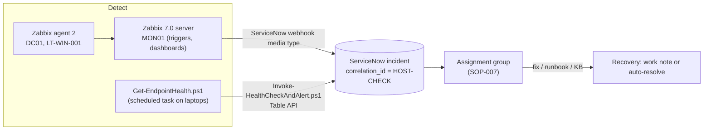

# 04 · Monitoring & Alerting

Two complementary detection paths feed the same ServiceNow incident queue, de-duplicated by `correlation_id`:



Thresholds and the severity → priority mapping are defined in
[01-lab-design.md §9](01-lab-design.md#9-monitoring--alerting-design). The response procedure is
[SOP-007](../sops/SOP-007-monitoring-alert-response.md).

## 1. Zabbix server

Deployed in [02-build-guide.md Phase 4](02-build-guide.md#phase-4---mon01-zabbix) with
`infrastructure/zabbix/docker-compose.yml` (PostgreSQL 16 + Zabbix 7.0 LTS server + web). Web UI:
`http://zabbix.corp.contoso.internal`.

Housekeeping in the UI: change the `Admin` password, set *Administration > General > GUI* time zone, create
host groups **Servers/Windows**, **Servers/Linux**, **Workstations**.

## 2. Agents

Install **Zabbix agent 2 (7.0 LTS, Windows, OpenSSL MSI)** from zabbix.com on DC01 and LT-WIN-001:

```powershell
# use the exact file name you downloaded, e.g. zabbix_agent2-7.0.<patch>-windows-amd64-openssl.msi
msiexec /i .\zabbix_agent2-7.0.x-windows-amd64-openssl.msi /qn SERVER=10.10.10.20 SERVERACTIVE=10.10.10.20 HOSTNAME=$env:COMPUTERNAME
New-NetFirewallRule -DisplayName 'Zabbix agent (passive)' -Direction Inbound -Protocol TCP -LocalPort 10050 `
    -RemoteAddress 10.10.10.20 -Action Allow -Profile Domain
```

On **DC01** merge `infrastructure/zabbix/zabbix_agent2.dc01.conf` into
`C:\Program Files\Zabbix Agent 2\zabbix_agent2.conf` (adds `Timeout=15` and the DHCP scope UserParameters),
then `Restart-Service 'Zabbix Agent 2'`.

> In production you would deploy the MSI through GPO software installation or Intune, under a standard change.

## 3. Hosts and templates

*Data collection > Hosts > Create host*:

| Host | Group | Interface | Templates |
|---|---|---|---|
| DC01 | Servers/Windows | Agent 10.10.10.10:10050 | *Windows by Zabbix agent active*, *ICMP Ping* |
| LT-WIN-001 | Workstations | Agent (DHCP - use DNS name `lt-win-001.corp.contoso.internal`) | *Windows by Zabbix agent active* |
| MON01 | Servers/Linux | Agent 127.0.0.1 or none | *Zabbix server health* |

The host name in Zabbix must equal the agent's `Hostname` (the computer name).

## 4. Custom items and triggers on DC01

*Data collection > Hosts > DC01 > Items > Create item*, then a trigger for each:

| Item key | Type | Trigger expression | Severity | → Priority |
|---|---|---|---|---|
| `service.info[NTDS,state]` | Zabbix agent (active) | `last(/DC01/service.info[NTDS,state])<>0` | Disaster | P1 |
| `service.info[DNS,state]` | Zabbix agent (active) | `last(/DC01/service.info[DNS,state])<>0` | High | P2 |
| `service.info[DHCPServer,state]` | Zabbix agent (active) | `last(/DC01/service.info[DHCPServer,state])<>0` | High | P2 |
| `dhcp.scope.state[10.10.10.0]` | Zabbix agent (active), text | `last(/DC01/dhcp.scope.state[10.10.10.0])<>"Active"` | High | P2 |
| `dhcp.scope.free[10.10.10.0]` | Zabbix agent (active), numeric | `last(/DC01/dhcp.scope.free[10.10.10.0])<10` | Warning | P4 |
| `net.tcp.service[tcp,,389]` | Simple check | `max(/DC01/net.tcp.service[tcp,,389],3m)=0` | High | P2 |

`service.info[<name>,state]` returns 0 when running and 6 when stopped. Add a **dependency** from each
service trigger to the template's *Zabbix agent is not available* trigger, so a dead DC raises one alert,
not ten.

## 5. Dashboard

*Dashboards > Create dashboard* **Contoso Infrastructure**: *Problems* (severity ≥ Warning), *Host
availability*, *Graph* (DC01 CPU and memory), *Item value* (`dhcp.scope.free`), *Top hosts* by C: free space.

📸 The dashboard during the `DhcpServiceDown` scenario with the problem visible.

## 6. Alert → incident (Zabbix webhook)

1. *Alerts > Media types* → **ServiceNow** (shipped with Zabbix) → fill the instance URL, the integration user
   `svc.helpdesk.automation` and its password → **Test**. The media type's README (in the Zabbix git repository
   under `templates/media/servicenow`) lists its parameters, including the severity-to-urgency mapping - set it
   to match §9 (Disaster/High → urgency 1, Average → 2, Warning → 3).
2. *Users > Users > Create user* `servicenow-integration` → *Media*: type ServiceNow, *Send to* any text,
   severities Warning and above. Give it a user role with read access to the three host groups.
3. *Alerts > Actions > Trigger actions > Create action* **Create ServiceNow incident**: conditions
   *Trigger severity ≥ Warning* and *Host group* in the three groups; operation *Send message to user
   servicenow-integration via ServiceNow*; add *Recovery* and *Update* operations so the incident is updated
   (and resolved) when the problem clears.
4. Use *Data collection > Maintenance* during approved change windows so planned work does not open incidents -
   tie the maintenance period to the CHG number.

## 7. Endpoint health → incident (PowerShell path)

Zabbix sees servers well; the endpoint script adds laptop-level checks (pending reboot, Defender signatures,
stopped services, disk with absolute floors) and works off-network too.

```powershell
# one-time: store the integration credential (DPAPI - only this user on this machine can read it)
New-Item -ItemType Directory $env:LOCALAPPDATA\ContosoHelpDesk -Force | Out-Null
Get-Credential svc.helpdesk.automation | Export-Clixml $env:LOCALAPPDATA\ContosoHelpDesk\snow.cred

cd C:\Lab\Enterprise-IT-HelpDesk-Lab\scripts\powershell\integration
.\Invoke-HealthCheckAndAlert.ps1 -DryRun                                     # see what would be sent
.\Invoke-HealthCheckAndAlert.ps1 -InstanceUrl https://devNNNNN.service-now.com `
    -CredentialPath $env:LOCALAPPDATA\ContosoHelpDesk\snow.cred -AutoResolve      # run once
.\Invoke-HealthCheckAndAlert.ps1 -InstanceUrl https://devNNNNN.service-now.com `
    -CredentialPath $env:LOCALAPPDATA\ContosoHelpDesk\snow.cred -AutoResolve -RegisterScheduledTask -IntervalMinutes 30
```

Behaviour (verified against `tests/mock_servicenow.py`):

| Run | Condition | ServiceNow action |
|---|---|---|
| 1 | Check fails (e.g. `Disk-C` critical) | Incident created, impact 3 × urgency 1 = **P3**, group Contoso Desktop Support, `correlation_id = LT-WIN-001-Disk-C` |
| 2 | Still failing | Work note added (throttled to one every 4 h unless severity changes) - **no duplicate** |
| 3 | Check OK again | Work note "condition cleared", or **resolved** with `-AutoResolve` |

## 8. Test the whole chain

| Test | Command | Expected |
|---|---|---|
| Service outage | `Invoke-LabFault.ps1 -Scenario DhcpServiceDown` on DC01 | Zabbix *High* problem in ≤ 2 min → ServiceNow **P2** for Contoso Infrastructure Ops → revert → problem resolves |
| Scope disabled | `Invoke-LabFault.ps1 -Scenario DhcpScopeDown` on DC01 | `dhcp.scope.state` trigger fires even though the service is running |
| Laptop disk | `Invoke-LabFault.ps1 -Scenario DiskFull` on LT-WIN-001 | Zabbix disk trigger and the endpoint script both alert; the incident is de-duplicated by correlation ID |

Record detection time, response time and restore time for each run - they feed the MTTA/MTTR discussion in
[07-metrics-reporting.md](07-metrics-reporting.md) and the post-incident review template.

## 9. Alert hygiene rules

- Every alert must be **actionable** and map to a KB or SOP; otherwise tune it (via a standard change).
- Prefer *sustained* conditions (`min(…,5m)`) over single samples for CPU and memory.
- Use trigger dependencies and maintenance windows to prevent alert storms.
- Review the top 10 noisiest triggers monthly; any trigger that auto-resolves more than 5 times a week
  without human action becomes a problem candidate.
