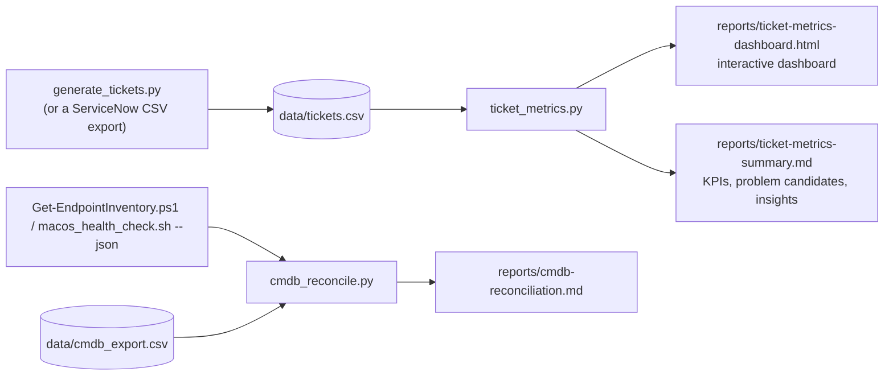

# 07 · Metrics & Reporting

"Experience tracking and improving support metrics" means turning ticket data into decisions. The lab does
that with three standard-library Python scripts - no packages to install.



## Run it

```powershell
python scripts/python/generate_tickets.py            # 504 simulated tickets, 2026-08-09 to 2026-11-06 (seed 42)
python scripts/python/ticket_metrics.py              # dashboard + summary for the last 30 / 60 / 90 days
python scripts/python/cmdb_reconcile.py              # CMDB data-quality report from the sample inventory
start reports\ticket-metrics-dashboard.html
```

With real data, export incidents from ServiceNow ([03 §9](03-servicenow-itsm.md#9-export-for-the-metrics-script))
and run `python scripts/python/ticket_metrics.py --input incident.csv --note "ServiceNow PDI export"`.

## KPI definitions

| KPI | Definition used by the script | Target |
|---|---|---|
| Resolution SLA attainment | Resolved incidents whose opened → resolved time is within the priority target (P1 4 h … P5 120 h) | ≥ 90% overall, ≥ 95% for P1/P2 |
| Response SLA | Acknowledged within P1 15 min … P5 24 h | ≥ 95% |
| First-contact resolution (FCR) | Resolved by the Service Desk on the first contact, no reassignment | ≥ 70% |
| MTTR | Median (and P90) calendar hours to resolve - the median resists outliers such as parts on order | Trending down |
| Reopen rate | Resolved incidents reopened by the caller | ≤ 5% |
| Reassigned 2+ times | Incidents that bounced between groups ("ping-pong") | ≤ 10% |
| Aged backlog | Open tickets older than 14 days, as a share of the open backlog | ≤ 5% |
| CSAT | Mean survey score (1-5) | ≥ 4.5 |
| KB link rate | Resolved incidents with a linked KB article | ≥ 60% |
| Problem candidate | Same symptom 5+ times in 7 days and ≥ 3× its normal weekly rate (review trigger: 3 in 7 days) | Every candidate gets a PRB decision |

## What the simulated 90-day dataset shows

From `reports/ticket-metrics-summary.md` (simulated data - regenerate to reproduce):

| KPI | Result | Status |
|---|---|---|
| Resolution SLA | 92.2% | Meets target, but **P2 is 71.4%** (10 of 14) |
| First-contact resolution | 61.4% | Misses target - lowest in Hardware (30%) and Network (43%) |
| Median time to resolve | 4.8 h | Network Operations median 39 h, SLA 65% |
| Response SLA | 95.7% | Meets target |
| Reopen / reassignment | 2.6% / 3.6% | Healthy |
| Aged backlog | 4 of 14 open > 14 days | Misses target (on hold for vendors) |
| CSAT | 4.4 | Misses target; SLA misses score 3.3 vs 4.5 |
| KB link rate | 53.8% | Misses target |

**Problem candidates detected** (all four were seeded into the data on purpose, and the detector finds
exactly these four, with no false positives):

| Symptom | Incidents | Peak 7 days | Matching lab artefact |
|---|---|---|---|
| Account locked again this week (Finance) | 24 | 10 from Oct 27 | [PRB0040001](../itil/examples/PRB0040001-recurring-account-lockouts.md) |
| Outlook keeps prompting for password | 18 | 9 from Oct 15 | KB0014 + change review |
| VPN disconnects every 30 minutes | 15 | 8 from Oct 12 | KB0006 + Network Ops problem |
| No network - 169.254 address | 9 | 7 on Nov 5 | [INC0010007 PIR](../itil/examples/INC0010007-dhcp-scope-outage-pir.md) |

## From numbers to actions

| Finding | Action | Owner | How you would measure it |
|---|---|---|---|
| Password resets + lockouts = 85 incidents (~28/month) | Self-service password reset with MFA; lockout-source KB | Identity & Access | Account & Access share of volume ↓ |
| P2 SLA 71% | Review P2 queue handling; 75% SLA warning notifications to the lead | Service Desk lead | P2 attainment ≥ 95% |
| FCR 61%: Hardware, Network lowest | Tier 1 runbooks (VPN, Wi-Fi, dock) + KB coverage | Knowledge manager | FCR ≥ 70%, KB link rate ≥ 60% |
| Four problem candidates | Open PRBs, RCA, link incidents, publish known errors | Problem manager | Repeat incidents per symptom ↓ |
| Aged backlog 29% | Weekly on-hold review with vendor ETAs | Desktop Support lead | Aged share ≤ 5% |

## CMDB reconciliation (control BC-11)

`cmdb_reconcile.py` compares discovered devices with the CMDB export. The sample data seeds one of each
problem; the report finds all of them:

| Finding | Example | Why it matters |
|---|---|---|
| UNREGISTERED | LT-WIN-003 (new hire's laptop) not in the CMDB | Unmanaged asset; incidents can't link to a CI |
| RETIRED_ONLINE | LT-WIN-006 retired but still reporting | Security risk: retired asset still in use |
| DUPLICATE_CI | LT-WIN-005 and LT-WIN-005-OLD share a serial | Split history, wrong impact analysis |
| STALE_CI | LT-WIN-004 not seen for 55 days | Lost device? Licence waste? |
| BAD_SERIAL | LT-WIN-008 "To be filled by O.E.M." | Warranty and audit matching fail |
| OWNER_DRIFT | LT-MAC-002 assigned to one user, used by another | Wrong caller and contact during an incident |
| OS_DRIFT / RAM_DRIFT | LT-WIN-001 CMDB still says 23H2 / 8 GB | Patch-compliance reporting is wrong |

## Screenshot checklist for the portfolio

- The dashboard (light mode) with the 90-day view, and the 30-day view (the filter recomputes everything)
- The recurring-issues table showing the four problem candidates
- `cmdb-reconciliation.md` rendered on GitHub
- A ServiceNow report or dashboard built from your own PDI tickets ([03 §8](03-servicenow-itsm.md#8-reports-and-dashboard))
