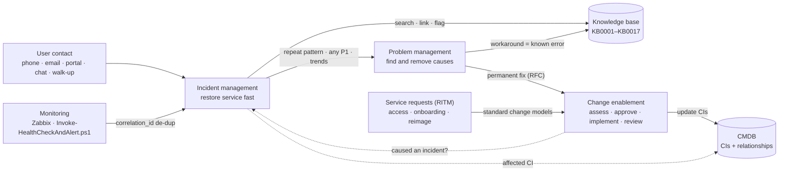

# ITIL 4 Practices: How Service Management Runs in This Lab

This folder defines how the Contoso Financial IT team handles incident, problem, change and
knowledge work. These are operating procedures for a small enterprise IT team, not ITIL theory. Every
rule uses the lab's real assignment groups, SLAs, scripts and ServiceNow records.

The priority matrix, SLA targets, KPI targets, record numbering and alert mapping are defined once in
[docs/01-lab-design.md](../docs/01-lab-design.md) (§8–§10). If a value changes, it changes there first.

## How the practices connect

How to read the flow, using the lab's example records:

1. **Detect.** A user calls, or monitoring raises an alert. Zabbix (webhook) and
   `Invoke-HealthCheckAndAlert.ps1` create incidents with `correlation_id = <HOST>-<CHECK>`, so a repeating
   alert adds a work note to the open incident instead of creating a duplicate.
2. **Restore.** The Service Desk restores service with a knowledge article (for example
   [KB0001](../knowledge-base/KB0001-account-lockout.md)) and escalates within 20 minutes if it is stuck.
3. **Prevent recurrence.** Three lockouts in four days triggered
   [PRB0040001](examples/PRB0040001-recurring-account-lockouts.md). RCA found stale saved credentials, and
   the workaround was published as a known error in KB0001.
4. **Fix permanently, under control.** Configuration fixes go through an RFC, for example
   [CHG0030001](examples/CHG0030001-deploy-workstation-baseline-gpo.md) for the workstation baseline GPO.
5. **Keep the CMDB true.** Every incident names its CI (LT-WIN-001, DC01, …), and every change updates
   the CIs it touches. Inventory sync (`Sync-InventoryToCmdb.ps1`) and `cmdb_reconcile.py` catch drift.
6. **Learn from major incidents.** The DHCP outage
   [INC0010007](examples/INC0010007-dhcp-scope-outage-pir.md) produced a blameless PIR, a problem record and
   corrective changes.

## Terminology (ITIL 4 vs ITIL v3 vs ServiceNow)

ITIL 4 describes **practices** (organizational capabilities). ITIL v3 described **processes**. This repo
keeps the familiar file names. Each document names the ITIL 4 practice it implements.

| This repo | ITIL 4 practice | ITIL v3 name | ServiceNow (PDI) |
|---|---|---|---|
| Incident management | Incident management | Incident management | Incident |
| Problem management | Problem management | Problem management | Problem |
| Change management | **Change enablement** (earlier ITIL 4 material: change control) | Change management | Change |
| Knowledge management | Knowledge management | Knowledge management | Knowledge |
| CMDB | Service configuration management | Service asset & configuration management | CMDB / Configuration |
| Service requests | Service request management | Request fulfilment | Service Catalog → RITM |
| Monitoring → incidents | Monitoring and event management | Event management | Incident (created by webhook / Table API) |
| Service Desk | Service desk (a practice) | Service desk (a function) | Assignment group *Contoso Service Desk* |

## Index

| Document | Use it when |
|---|---|
| [incident-management.md](incident-management.md) | Logging, prioritizing, escalating, resolving and closing incidents; SLAs; major-incident triggers |
| [problem-management.md](problem-management.md) | Something keeps happening, or a P1 occurred: RCA, workarounds, known errors |
| [change-management.md](change-management.md) | Anything changes GPOs, DNS, DHCP, AD policy, monitoring or integrations |
| [knowledge-management.md](knowledge-management.md) | Writing, reviewing, publishing and retiring KB articles (KCS) |
| [templates/RFC-template.md](templates/RFC-template.md) | Raising a change |
| [templates/RCA-problem-record-template.md](templates/RCA-problem-record-template.md) | Documenting a problem investigation |
| [templates/major-incident-communication-template.md](templates/major-incident-communication-template.md) | Running a P1 bridge and sending notices |
| [templates/KB-article-template.md](templates/KB-article-template.md) | Creating a new KB article |
| [templates/ticket-work-note-template.md](templates/ticket-work-note-template.md) | Writing work notes, escalation notes and customer updates |
| [examples/](examples/) | Filled records: a normal change, a problem record, a major-incident PIR |

## Example records used across the lab

| Record | What it is | Date (2026) |
|---|---|---|
| CHG0030001 | Normal change: deploy `CON-C-Workstation-Baseline` (pilot → production) | Oct 5–15 |
| INC0010002 – INC0010006 | Finance account lockouts linked to PRB0040001 | Oct 27 – Nov 3 |
| PRB0040001 | Recurring account lockouts after password changes | Opened Oct 30 |
| INC0010007 | **P1 major incident**: DHCP scope inactive; children INC0010008 – INC0010010 | Nov 5 |
| CHG0030002 | Emergency change: re-activate DHCP scope during INC0010007 | Nov 5 |
| PRB0040002 | Problem opened for the P1 (tracks PIR corrective actions) | Nov 5 |
| CHG0030003 | Normal change (proposed): move mobile mail to a modern-auth client (PRB0040001) | Nov 6 |
| CHG0030004 | Normal change: Zabbix monitoring of DHCP scope state and free leases (PIR action) | Nov 9 |
| RITM0010003 | New-hire laptop provisioning that INC0010007 delayed | Nov 5 |

These records are **simulated**. They are written as if produced while running the lab's training
scenarios ([docs/06-lab-scenarios.md](../docs/06-lab-scenarios.md)) inside the fictional 50-user Contoso
environment. To rehearse them for real, create the same records in your ServiceNow PDI
([docs/03-servicenow-itsm.md](../docs/03-servicenow-itsm.md)).
