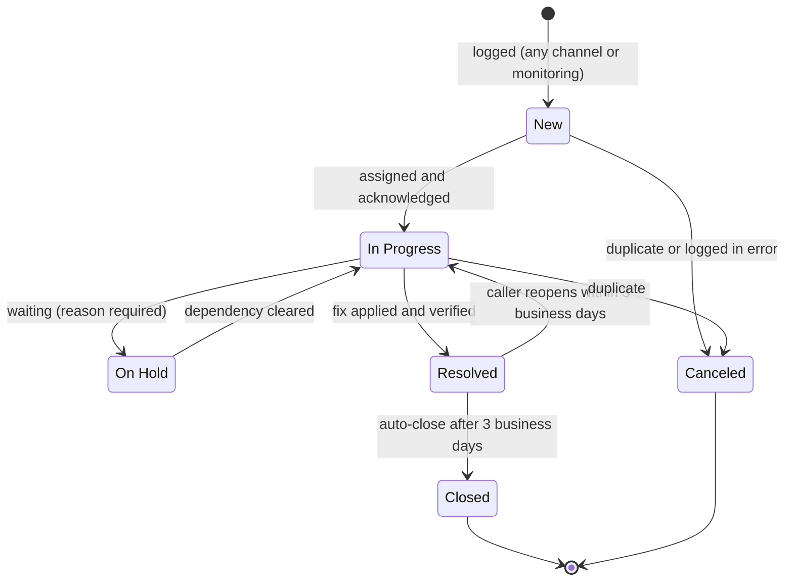

# Incident Management

| | |
|---|---|
| **ITIL 4 practice** | Incident management |
| **Practice owner** | Service Desk lead (*Contoso Service Desk*) |
| **Applies to** | Windows and macOS laptops, mobile devices, accounts, network, printing, Microsoft 365 apps, lab servers |
| **Tool** | ServiceNow PDI → Incident ([setup guide](../docs/03-servicenow-itsm.md)) |
| **Values from** | [Lab design §8–§9](../docs/01-lab-design.md) (priority, SLA, KPIs, groups, alert mapping) |

## 1. Objective

Restore normal service as fast as possible with the least business impact. Leave a record clear enough
for the next analyst, the problem manager and an auditor to follow.

## 2. Scope

| In scope | Handled elsewhere |
|---|---|
| Unplanned interruption or degradation: "I'm locked out", "no network", "Outlook keeps prompting", "print jobs stuck" | **Service requests** (new hire, share access, software) → RITM |
| Monitoring alerts from Zabbix and `Invoke-HealthCheckAndAlert.ps1` | **Planned work** → CHG ([change management](change-management.md)) |
| User-reported security events (phishing, lost device → [SOP-006](../sops/SOP-006-lost-stolen-device.md)) | **Root-cause work** → PRB ([problem management](problem-management.md)) |

Rule of thumb: something is **broken or degraded** → incident. Something **new is wanted** → request.

## 3. Lifecycle and states



| State | Entry criteria | SLA clock |
|---|---|---|
| **New** | Record created from any channel | Response and resolution clocks start |
| **In Progress** | Assigned to a person who has acknowledged it and made first contact | Response clock stops |
| **On Hold** | On-hold reason chosen and explained in work notes | Resolution clock pauses **only** for *Awaiting Caller* |
| **Resolved** | Resolution code + resolution notes + caller informed | Resolution clock stops |
| **Closed** | Automatically 3 business days after Resolved, or on caller confirmation | — |
| **Canceled** | Duplicate (link the original) or logged in error (Service Desk lead approves) | Canceled |

**On-hold reasons** (ServiceNow defaults):

- **Awaiting Caller.** Make three contact attempts over three business days (phone, email, Teams). If
  there is no reply, resolve with *No resolution provided* and tell the caller how to reopen.
- **Awaiting Change.** Link the CHG and keep the customer update cadence.
- **Awaiting Problem.** Link the PRB and apply the published workaround first.
- **Awaiting Vendor.** Record the vendor case number. The update cadence still applies.

## 4. Intake channels

| Channel | Logged by | Notes |
|---|---|---|
| Phone | Contoso Service Desk | Verify identity before any account action ([KB0002](../knowledge-base/KB0002-password-reset-identity-verification.md)) |
| Email | Contoso Service Desk | Reply within the response target |
| Self-service portal | Caller | Service Desk validates category and priority on triage |
| Chat | Contoso Service Desk | Attach the transcript |
| Walk-up / onsite | Contoso Desktop Support | Log before or right after the fix. **No ticket, no work** |
| Monitoring | Zabbix webhook, `Invoke-HealthCheckAndAlert.ps1` | Priority comes from the alert mapping (§9) |

**Mandatory fields:** caller, contact method and availability, configuration item (the device or service,
e.g. `LT-WIN-001`, `DC01`), category/subcategory, impact and urgency (ServiceNow calculates priority),
assignment group.

**Short description format:** `<Symptom> – <who/what>`. Examples: *Account locked out – emma.carter*,
*APIPA address, no network – LT-WIN-002*.

**Description:** exact error text, when it started, what changed, what the caller already tried, and
scope (just me / my team / everyone).

## 5. Categorization

| Category (label → value) | Subcategories |
|---|---|
| Account & Access → `account` | password reset, account lockout, MFA, access request |
| Hardware → `hardware` | laptop, battery/power, dock/monitor, peripherals, disk, BitLocker |
| Software → `software` | OS, Microsoft 365 apps, application install, Windows Update |
| Network → `network` | dns, dhcp, vpn, wireless, file share |
| Email & Collaboration → `email` | Outlook, mailbox, Teams |
| Mobile Device → `mobile` | enrollment, email on device, lost/stolen |
| Printing → `printing` | print queue, printer mapping |
| Security → `security` | phishing report, malware alert, suspicious sign-in |

Categorize by **symptom at logging** and correct it to **cause at resolution**. Problem management's trend
reports depend on accurate resolution categories.

## 6. Prioritization

| Impact ↓ / Urgency → | 1 – High | 2 – Medium | 3 – Low |
|---|---|---|---|
| **1 – High** (enterprise, a critical service, many users) | **P1 Critical** | P2 High | P3 Moderate |
| **2 – Medium** (a department/group, or a VIP) | P2 High | P3 Moderate | P4 Low |
| **3 – Low** (a single user) | P3 Moderate | P4 Low | P5 Planning |

**Urgency:**

- **1 – High:** work stopped, no workaround, or a time-critical deadline (Finance close, a new hire's
  first hour).
- **2 – Medium:** degraded, or a workaround exists.
- **3 – Low:** an inconvenience that can wait.

| Situation | Impact | Urgency | Priority |
|---|---|---|---|
| DHCP scope inactive; devices needing a lease get 169.254.x.x ([INC0010007](examples/INC0010007-dhcp-scope-outage-pir.md)) | 1 | 1 | P1 |
| Finance department share unreachable during quarter-end close | 2 | 1 | P2 |
| VIP Olivia Bennett: mail on her phone stopped syncing, laptop works | 2 | 2 | P3 |
| Emma Carter locked out and cannot work | 3 | 1 | P3 |
| One user's print jobs stuck; another printer works | 3 | 2 | P4 |
| Outlook add-in icon missing, no work impact | 3 | 3 | P5 |

Never type a priority directly. Change impact or urgency and write the reason in the work notes. Re-assess
priority whenever scope changes, for example when a second department reports the same symptom.

## 7. SLA targets

| Priority | Response (acknowledge) | Resolution | Customer update cadence |
|---|---|---|---|
| P1 Critical | 15 min | 4 h | Every 30 min |
| P2 High | 30 min | 8 h | Every 2 h |
| P3 Moderate | 2 h | 24 h | Daily |
| P4 Low | 8 h | 72 h | Every 2 days |
| P5 Planning | 24 h | 120 h | Weekly |

- **Response** means the assignee set *In Progress* and recorded first contact (a call or a customer-visible
  comment).
- **Resolution** runs from opened to Resolved and pauses only for *On Hold – Awaiting Caller*.
- All targets are **calendar hours** in the lab (24×7 SLA schedules in the PDI).
- At **75%** of the resolution target, the group's team lead is notified. A breach needs a breach reason in
  the work notes and is reviewed at the weekly operations review.

## 8. Escalation

**Functional escalation** moves the ticket to the group that can fix it. Tier 1 escalates after **20
minutes without progress**, or immediately if the fix needs physical access, elevated rights or an
infrastructure change.

| Symptom or need | Escalate to |
|---|---|
| Laptop hardware, OS repair or reimage, BitLocker recovery, LAPS, printers, macOS, mobile devices, endpoint alerts | **Contoso Desktop Support** (Tier 2, onsite) |
| AD accounts or groups beyond reset/unlock, onboarding/offboarding, privileged access, access reviews | **Contoso Identity & Access** |
| DNS, DHCP, VPN, Wi-Fi, firewall, "everyone on the subnet" connectivity | **Contoso Network Operations** |
| DC01 and MON01, AD DS health, file services, monitoring platform, server alerts | **Contoso Infrastructure Ops** |

Every escalation needs an escalation work note
([template](templates/ticket-work-note-template.md#escalation-note)) and a customer-visible comment saying
what happens next. Escalate the ticket, not the problem: the receiving group must not need to call the user
again for facts already known.

**Hierarchical escalation** tells management.

| Trigger | Notify |
|---|---|
| Any P1 | Major Incident Manager **immediately** → [SOP-005](../sops/SOP-005-major-incident-communications.md) |
| Any ticket at 75% of its resolution SLA | Team lead of the assignment group |
| P2 with no progress for 1 hour | Team lead |
| Complaint or second reopen by the caller | Service Desk lead |

## 9. Monitoring-generated incidents

| Source severity | Impact | Urgency | Priority | Assignment group |
|---|---|---|---|---|
| Zabbix *Disaster* (server) | 1 | 1 | P1 | Contoso Infrastructure Ops |
| Zabbix *High* (server) | 2 | 1 | P2 | Contoso Infrastructure Ops |
| Zabbix *Average* (server) | 2 | 2 | P3 | Contoso Infrastructure Ops |
| Zabbix *Warning* (any) | 3 | 2 | P4 | Owning group |
| Endpoint health *Critical* | 3 | 1 | P3 | Contoso Desktop Support |
| Endpoint health *Warning* | 3 | 2 | P4 | Contoso Desktop Support |

- **De-duplication:** every automated incident carries `correlation_id = <HOST>-<CHECK>`. While an incident
  with that ID is open, new alerts add a work note instead of a new record.
- Automated priority is a starting point. The analyst re-assesses on triage. For example, DNS down on DC01
  for everyone becomes Impact 1, and the reason goes in the work notes.
- Monitoring alert handling is detailed in [SOP-007](../sops/SOP-007-monitoring-alert-response.md) and
  [docs/04-monitoring-alerting.md](../docs/04-monitoring-alerting.md).

## 10. Major incidents

Declare a major incident ([SOP-005](../sops/SOP-005-major-incident-communications.md)) when:

- the incident is **P1**;
- **3 or more incidents with the same symptom arrive within 30 minutes** (possible common cause). The
  Service Desk lead decides within 10 minutes;
- a **core service** (AD sign-in, DNS, DHCP, file shares, email) is lost for a whole department or more;
- a **security event** may expose data, such as a lost unencrypted device or spreading malware (with
  [SOP-006](../sops/SOP-006-lost-stolen-device.md)).

To declare: promote the first incident to major (or create a parent), link related incidents as children,
open the bridge, and send the first notice within 15 minutes. A blameless PIR follows within 3 business
days. See the example [INC0010007 PIR](examples/INC0010007-dhcp-scope-outage-pir.md).

## 11. Documentation standard

| Field | Audience | Write |
|---|---|---|
| **Work notes** | IT staff only | *Issue → Steps taken → Result → Next action*, plus the commands and scripts run (with parameters) and their key output |
| **Additional comments** | The caller (customer-visible) | Plain language: what we found, what we did, what happens next, and when they will hear from us |

Never record passwords (including temporary ones), LAPS passwords, BitLocker recovery passwords, MFA codes,
or personal data the fix does not need. For BitLocker, record only the **8-character key ID** and the
**identity verification method**. Example work note line:

```
Ran Get-AccountLockoutInfo.ps1 -SamAccountName emma.carter → locked on DC01, BadLogonCount 5,
source LT-WIN-001 (event 4740 at 09:02). KB0001 applied. Unlocked with -Unlock.
```

## 12. Resolution and closure

- **Resolution codes (lab list):** Solution provided · Workaround provided · Resolved by change · Resolved by
  problem · User error / training · Duplicate · No resolution provided. Use the closest code your PDI release
  offers; older releases use *Solved (Permanently)* and similar.
- **Resolution notes** state the cause, the fix, how it was verified and the KB used, or "KB gap flagged".
- **Confirm before resolving.** For P3–P5, confirm with the caller (call or comment). If they cannot be
  reached, resolve and say how to reopen. For P1–P2, the service owner confirms restoration. Child
  incidents resolve with the parent.
- **Auto-close:** Resolved incidents close after **3 business days**. PDI: *Incident → Administration →
  Incident Properties*, auto-close days = 3. The platform counts calendar days, so the lab approximates
  business days.
- **Reopen:** a caller reply inside the window returns the ticket to *In Progress* and increments the reopen
  count. After closure, open a new incident linked to the old one.

## 13. KPIs

| KPI | Definition | Target | Source |
|---|---|---|---|
| First Contact Resolution (FCR) | Tier 1 incidents resolved on first contact without escalation | ≥ 70% | `ticket_metrics.py` |
| SLA attainment (resolution) | Resolved within the target for its priority | ≥ 95% P1/P2, ≥ 90% overall | `ticket_metrics.py`, PDI SLA report |
| SLA attainment (response) | Acknowledged within the response target | ≥ 95% | same |
| MTTA / MTTR | Mean/median time to acknowledge / resolve, by priority | Trending down | same |
| Reopen rate | Resolved tickets reopened by the caller | ≤ 5% | same |
| Reassignment rate | Tickets with ≥ 2 reassignments ("ping-pong") | ≤ 10% | same |
| Backlog aging | Open tickets older than 14 days | ≤ 5% of backlog | same |
| CSAT | Post-resolution survey (1–5) | ≥ 4.5 | same |

Reports: `python scripts/python/ticket_metrics.py --input data/tickets.csv --outdir reports`
([docs/07-metrics-reporting.md](../docs/07-metrics-reporting.md)). The script also accepts a ServiceNow
incident CSV export.

## 14. RACI

R = Responsible · A = Accountable · C = Consulted · I = Informed

| Activity | Caller | Service Desk (T1) | Desktop Support (T2) | Resolver group (T3) | Service Desk lead | Major Incident Mgr | IT Manager (Lucas Moreno) |
|---|---|---|---|---|---|---|---|
| Report the issue and provide details | R | C | C | | | | |
| Log, categorize, prioritize | C | R | R (walk-up) | | A | | |
| Diagnose with KB and scripts | C | R | R | R | A | | |
| Functional escalation | I | R | R | C | A | | |
| Resolve and verify | C | R | R | R | A | | |
| Customer updates | I | R | R | C | A | | |
| Declare major incident | | C | C | C | R | A | I |
| Run bridge and comms (P1) | I | C | C | R | C | A | I |
| Close / auto-close | C | R | | | A | | |
| Weekly KPI review | | C | C | C | R | | A |

## Related

[Problem management](problem-management.md) · [Knowledge management](knowledge-management.md) ·
[SOP-004 Triage & escalation](../sops/SOP-004-incident-triage-escalation.md) ·
[SOP-005 Major incident](../sops/SOP-005-major-incident-communications.md) ·
[Work note template](templates/ticket-work-note-template.md) · [Lab scenarios](../docs/06-lab-scenarios.md)
