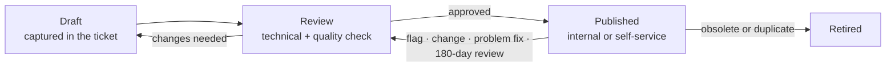

# Knowledge Management (KCS)

| | |
|---|---|
| **ITIL 4 practice** | Knowledge management |
| **Method** | Knowledge-Centered Service (KCS v6) |
| **Knowledge owner** | Service Desk lead (publisher for the Service Desk knowledge base) |
| **Where** | [`knowledge-base/`](../knowledge-base/) (repo, KB0001–KB0017) · ServiceNow PDI → Knowledge |
| **Template** | [KB article template](templates/KB-article-template.md) |

## 1. Objective

Capture what the team learns **while solving tickets**, so the next analyst or the user solves the same
issue faster. Knowledge is a by-product of incident work, not a separate documentation project.

## 2. KCS in this lab

### Solve loop: done on every ticket

| Practice | What analysts actually do |
|---|---|
| **Capture** | Record the user's symptom and exact error text in the ticket, in their words. That text becomes the article title and symptoms |
| **Structure** | Fill the standard sections (symptoms, causes, checks, resolution, escalation, verification). One problem per article |
| **Reuse** | **Search early, search often.** Search the KB on the user's words *before* troubleshooting, and again when the symptom changes. Link the article you used to the incident |
| **Improve** | **Flag it or fix it.** If an article is wrong or incomplete, fix it (if you hold Contributor rights) or flag it with a comment explaining what failed |

### Evolve loop: done by the knowledge owner monthly

| Practice | In this lab |
|---|---|
| Content health | Review flags, articles past their review date, and top-used articles |
| Process integration | Problem → known error → KB is mandatory ([problem management §5](problem-management.md)); changes that alter a procedure update the KB before closure |
| Performance assessment | Metrics in §7 are reviewed at the weekly operations review |
| Leadership & communication | New and changed articles are announced in the Service Desk huddle |

## 3. Roles and rights

| KCS role | Who | Can |
|---|---|---|
| **KCS Candidate** | New Service Desk analysts | Search, link, flag; create drafts reviewed before use |
| **KCS Contributor** | Tier 1 after 30 days, Tier 2/3 | Create and edit internal articles; publish internal minor fixes |
| **KCS Publisher** | Service Desk lead, group leads | Publish to the self-service audience; retire articles |
| **Knowledge Domain Expert** | Group lead per domain (Network, Identity, Desktop, Infra) | Technical review of articles in their domain |
| **Coach** | Service Desk lead | Reviews article quality with analysts monthly |

## 4. Article lifecycle

| State | Entry | Exit | Who |
|---|---|---|---|
| **Draft** | Created from a ticket (ServiceNow: *Knowledge* checkbox on the incident resolution) or manually | Submitted for review | Candidate / Contributor |
| **Review** | Submitted, flagged, or review date reached | Domain expert confirms technical accuracy; publisher checks quality | Domain expert + publisher |
| **Published** | Approved for its audience | Next review in **180 days**, or earlier when triggered | Publisher |
| **Retired** | Procedure no longer valid (CI decommissioned, tool replaced) or merged into another article | Kept read-only for 12 months for audit, then deleted | Publisher |

**Early review triggers:**

- a CHG that changes the procedure;
- a problem fix or new known error;
- **3 or more** "not helpful" flags;
- a step that failed during a lab scenario.

**Time to publish:** known-error workarounds within **1 business day**. Other articles within **5 business
days** of the draft.

## 5. Quality checklist (Article Quality Index)

Each published article is scored on these 10 checks. A score below 8 goes back to review.

1. **Title is the symptom in the user's words** ("Account locked out after password change", not "AD lockout policy").
2. **Applies to** is precise (OS, device type, domain-joined or not).
3. **One problem per article.** Related issues are linked, not merged.
4. **Quick checks fit in 2 minutes** and come before any change.
5. **Steps are numbered, tested in the lab, and copy-pasteable** (commands in code blocks).
6. **Escalation criteria are explicit:** when, to which assignment group, and what evidence to include.
7. **Verification** says how to prove it is fixed.
8. **No secrets or personal data** (no passwords, recovery keys, real names outside the lab personas).
9. **Audience is correct.** Internal-only steps never appear in self-service articles.
10. **Metadata is complete:** owner, last reviewed, related scripts and scenarios.

## 6. Audience and visibility

| Audience | Contains | Never contains | PDI setup |
|---|---|---|---|
| **Internal (Tier 1 / Tier 2 / Tier 3)** | Admin tools, scripts (`Get-AccountLockoutInfo.ps1`, `Get-BitLockerRecoveryKey.ps1`), console paths, escalation rules | — | Knowledge base *IT – Internal*, readable by `itil` |
| **End user (self-service)** | Safe steps: restart, reconnect, update the password on your phone, set up Authenticator, how to contact the Service Desk | Admin rights, LAPS, BitLocker key retrieval, registry edits, scripts | Knowledge base *Contoso Self-Service*, readable by all employees |

The articles in `knowledge-base/` are **internal**. A self-service version is created by copying the
article, keeping only user-safe steps, and publishing it to the self-service knowledge base.

## 7. Knowledge in the incident workflow

1. **Search** the user's words before diagnosing; record "KB searched: <terms>" if nothing fits.
2. **Use and link** the article (incident → *Attached Knowledge*). Record "KB0004 used, step 3 resolved".
3. **No article?** Resolve the incident with good resolution notes, tick *Knowledge* to create a draft, or
   create one from the [template](templates/KB-article-template.md).
4. **Article failed?** Flag it with what happened. Fix it if you are a Contributor.

## 8. Metrics (lab targets)

| Metric | Definition | Target |
|---|---|---|
| **KB link rate** | Resolved incidents with a linked article ÷ resolved incidents | ≥ 60% |
| **Self-service deflection** | Portal sessions that viewed an article and raised no ticket within 24 h ÷ portal sessions with an article view | ≥ 25% |
| Article reuse | Links per article per month (top 10 reviewed monthly) | Tracked |
| Time to publish | Draft → Published | ≤ 5 business days (≤ 1 for known errors) |
| Article health | Published articles past their review date | ≤ 10% |
| Flag resolution | Flags actioned | ≤ 5 business days |
| FCR contribution | FCR on incidents with a linked article vs. without | Higher with KB (see [incident KPIs](incident-management.md#13-kpis)) |

## 9. Articles mapped to lab scenarios

Each training scenario ([docs/06-lab-scenarios.md](../docs/06-lab-scenarios.md)) is solved with a specific
article, which doubles as a test of the article. Articles with no scenario are rehearsed as tabletop
exercises or role-play calls.

| Scenario (`Invoke-LabFault.ps1 -Scenario`) | Article | Tools used in the article |
|---|---|---|
| `AccountLockout` | [KB0001](../knowledge-base/KB0001-account-lockout.md), [KB0002](../knowledge-base/KB0002-password-reset-identity-verification.md) | `Get-AccountLockoutInfo.ps1`, `Reset-UserPassword.ps1` |
| `DnsMisconfig` | [KB0004](../knowledge-base/KB0004-dns-resolution-failure.md) | `Invoke-NetworkTriage.ps1`, `Invoke-EndpointRemediation.ps1 -Action FlushDns` |
| `DhcpScopeDown`, `DhcpServiceDown` | [KB0005](../knowledge-base/KB0005-no-network-apipa-dhcp.md) | `Invoke-NetworkTriage.ps1`, `-Action RenewDhcp` |
| `ShareAccessRemoved` | [KB0007](../knowledge-base/KB0007-mapped-drive-access-denied.md) | Group membership checks, sign-out/sign-in |
| `WrongOU` | [KB0008](../knowledge-base/KB0008-group-policy-not-applying.md) | `gpresult`, `-Action GpUpdate` |
| `BrokenTrust` | [KB0009](../knowledge-base/KB0009-trust-relationship-failed.md) | `Get-LapsADPassword`, `-Action RepairSecureChannel` |
| `ClockSkew` | [KB0010](../knowledge-base/KB0010-kerberos-clock-skew.md) | `-Action SyncTime` |
| `BitLockerRecovery` | [KB0011](../knowledge-base/KB0011-bitlocker-recovery-key.md) | `Get-BitLockerRecoveryKey.ps1` |
| `SpoolerStuck` | [KB0012](../knowledge-base/KB0012-print-queue-stuck.md) | `-Action RestartSpooler` |
| `DiskFull` | [KB0013](../knowledge-base/KB0013-low-disk-space-slow-performance.md) | `Get-EndpointHealth.ps1`, `-Action DiskCleanup` |
| *(tabletop)* | [KB0003](../knowledge-base/KB0003-mfa-reregistration-new-phone.md), [KB0006](../knowledge-base/KB0006-vpn-connection-failure.md), [KB0014](../knowledge-base/KB0014-outlook-m365-sync-profile.md) | Role-play calls |
| *(tabletop / physical Mac)* | [KB0015](../knowledge-base/KB0015-macos-filevault-password-keychain.md), [KB0016](../knowledge-base/KB0016-macos-mdm-enrollment-performance.md) | `macos_health_check.sh` |
| *(tabletop / optional Intune)* | [KB0017](../knowledge-base/KB0017-mobile-enrollment-email-lost-device.md) | [SOP-006](../sops/SOP-006-lost-stolen-device.md) |

## Related

[Incident management](incident-management.md) · [Problem management](problem-management.md) ·
[KB template](templates/KB-article-template.md) · [Knowledge base index](../knowledge-base/)
