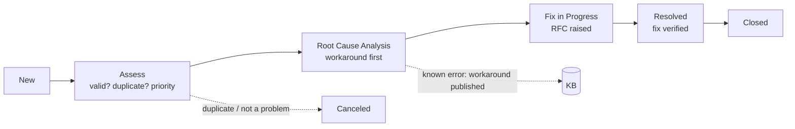

# Problem Management

| | |
|---|---|
| **ITIL 4 practice** | Problem management |
| **Problem manager** | Service Desk lead (small team: one person owns the practice) |
| **Problem owner** | Lead of the group that owns the fix (e.g. Contoso Network Operations for DHCP) |
| **Tool** | ServiceNow PDI → Problem · template: [RCA / problem record](templates/RCA-problem-record-template.md) |

## 1. Objective

Incidents restore service. Problems stop the same incident from happening again. Problem management
finds the cause, publishes a workaround quickly (known error), and drives a permanent fix through change
enablement.

| | Incident | Problem |
|---|---|---|
| Goal | Restore service now | Remove the cause |
| Clock | SLA (minutes/hours) | RCA targets (days) |
| Success | User is working | No recurrence |
| Example | INC0010002: Emma Carter locked out | PRB0040001: why Finance users keep getting locked out |

## 2. Triggers

| Type | Trigger | Who raises it |
|---|---|---|
| **Reactive** | **≥ 3 incidents with the same symptom or the same CI within 7 days** | Any analyst; Service Desk lead confirms |
| **Reactive** | **Any P1.** A problem record is always opened and linked to the major incident; the PIR's corrective actions are tracked there | Major Incident Manager |
| **Proactive** | Weekly trend review of the **recurring-issues table** from `ticket_metrics.py` (top repeated short descriptions, categories and CIs) | Service Desk lead |
| **Proactive** | Repeating monitoring alerts on the same host/check (same `correlation_id` reopened ≥ 3 times in 30 days) | Contoso Infrastructure Ops / Desktop Support |
| **Proactive** | Vendor advisories, patch notes and known issues affecting lab CIs | Owning resolver group |

```
python scripts/python/ticket_metrics.py --input data/tickets.csv --outdir reports
# Open reports/ and review the recurring-issues table: anything repeating ≥ 3 times in 7 days → problem candidate
```

## 3. Lifecycle



| State (ServiceNow) | Exit criteria |
|---|---|
| **New** | Linked incidents attached; problem statement written |
| **Assess** | Owner assigned; priority set; duplicate check done |
| **Root Cause Analysis** | Root cause statement agreed; workaround published if one exists (known error flag) |
| **Fix in Progress** | Permanent fix raised as an RFC (or risk acceptance approved by the IT Manager) |
| **Resolved** | Fix implemented **and** verification window passed with no recurrence (default **14 days**; 30 days for monthly-cycle issues) |
| **Closed** | Problem manager review: actions complete, KB updated, lessons captured |

**Problem priority** = impact of the linked incidents × frequency. A linked P1, or ≥ 10 incidents a month,
is **high**. 3–9 a month is **moderate**. Anything else is **low**.

## 4. Root cause analysis methods

Use the lightest method that gets to a cause you can act on. Most lab problems need 5 Whys plus a timeline.

### 4.1 Problem statement: Is / Is not

Define the problem before explaining it. The answers narrow the search.

| | IS | IS NOT |
|---|---|---|
| **What** | AD account lockouts after a password change | Users mistyping at sign-in |
| **Where** | Finance users; sources LT-WIN-001 and a phone mail client | Other departments |
| **When** | Within 24 h of a password change, repeating | Before the change |
| **Extent** | 5 incidents in 7 days, 2 users | Growing beyond users who changed passwords |

### 4.2 5 Whys

Ask "why" until you reach something the organization controls. Branch when two causes contribute. A good
final answer is a **process or design gap**, never "the user" or "the engineer". Worked example:
[PRB0040001](examples/PRB0040001-recurring-account-lockouts.md).

### 4.3 Ishikawa (fishbone): IT categories

| Category | Ask about |
|---|---|
| People | Skills, hand-offs, shift changes, unclear ownership |
| Process | KB gaps, SOP steps missing, change control bypassed |
| Technology | Configuration, software defects, capacity, single points of failure |
| Environment | Network, power, physical location, VM host resources |
| Suppliers | Cloud services, vendors, licensing |
| Monitoring | Missing items, wrong thresholds, alerts not routed |

### 4.4 Timeline reconstruction: lab data sources

| Evidence | Where | Command / location |
|---|---|---|
| Lockout source | Security log on DC01 (PDC emulator), event 4740 | `.\Get-AccountLockoutInfo.ps1 -SamAccountName <user>` |
| Policy actually applied | Target device | `gpresult /r /scope computer` · `gpresult /h C:\Temp\gp.html` |
| DHCP activity | DC01 audit log | `C:\Windows\System32\dhcp\DhcpSrvLog-<Day>.log` · `Get-DhcpServerv4Scope -ComputerName DC01` |
| Endpoint state | Device | `.\Get-EndpointHealth.ps1 -Format Json` · `.\Test-EndpointCompliance.ps1` |
| Network path | Device | `.\Invoke-NetworkTriage.ps1` |
| Monitoring history | Zabbix → *Monitoring → Problems* (history) | — |
| Ticket history | ServiceNow incident list grouped by CI / subcategory | — |

### 4.5 Change correlation: "what changed?"

Most outages follow a change. Check before you theorize:

```powershell
# Group Policy edits in the last 7 days
Get-GPO -All | Where-Object ModificationTime -gt (Get-Date).AddDays(-7) |
    Sort-Object ModificationTime -Descending | Select-Object DisplayName, ModificationTime
# Recent patches on the affected device
Get-HotFix | Sort-Object InstalledOn -Descending | Select-Object -First 5 HotFixID, InstalledOn
# DHCP scope state and options right now
Get-DhcpServerv4Scope -ComputerName DC01 | Select-Object ScopeId, Name, State, LeaseDuration
```

Then compare with the ServiceNow **change schedule** for the affected CIs. A configuration change with no
CHG record is an **unauthorized change**. Record it as a contributing factor, as in the INC0010007 PIR.

## 5. Workarounds and known errors

- **Workaround first.** As soon as a reliable workaround exists, record it in the problem's *Workaround* field
  and set **Known error**.
- **Publish it.** Add or update the KB article within **1 business day**, and label the section *Known error /
  workaround*. Example: the stale-credential cleanup added to
  [KB0001](../knowledge-base/KB0001-account-lockout.md).
- **Communicate it.** Post the workaround to every linked incident. New incidents matching the known error are
  linked to the problem and resolved with *Workaround provided*.
- The **KEDB** in this lab is the set of KB articles with a *Known error / workaround* section, plus problems
  flagged *Known error* in the PDI.

## 6. Permanent fix through change

| Fix type | Route | Example |
|---|---|---|
| Configuration (GPO, DNS, DHCP, AD, Zabbix) | RFC → [change management](change-management.md) | CHG0030004: Zabbix item for DHCP scope state |
| Documentation / process (KB, SOP, comms) | KB lifecycle or SOP revision, no CHG needed | KB0001 v1.1, SOP-004 repeat-lockout rule |
| Accept the risk | IT Manager (Lucas Moreno) approves in the problem record, with a review date | Single DHCP server in the lab (no failover) |

The problem stays in **Fix in Progress** until the change is implemented and closed *Successful*.

## 7. KPIs (lab targets)

| KPI | Target |
|---|---|
| Workaround published (known error) | ≤ 2 business days after the problem is logged |
| Root cause identified | ≤ 10 business days (≤ 5 for P1-linked problems) |
| Recurrence after the permanent fix | 0 linked incidents in the verification window |
| Proactive share | ≥ 25% of problems per quarter come from trend reviews |
| Open problems with an owner and a next action | 100% |
| Repeat incidents for the top-5 recurring issues | Lower every quarter (`ticket_metrics.py`) |

## 8. RACI

| Activity | Service Desk | Desktop Support | Resolver groups (IAM / Network / Infra) | Problem manager | IT Manager |
|---|---|---|---|---|---|
| Detect and log (triggers) | R | R | R | A | I |
| Assess and prioritize | C | C | C | R/A | I |
| Root cause analysis | C | R | R | A | I |
| Workaround and known-error KB | R | R | R | A | |
| RFC for the permanent fix | | R | R | A | C |
| Risk acceptance | | | C | R | A |
| Verify and close | C | C | C | R/A | I |
| Weekly trend review | C | C | C | R | A |

## 9. Practice in the lab: problem candidates from the scenarios

Run a scenario two or three times ([docs/06-lab-scenarios.md](../docs/06-lab-scenarios.md)) and treat the
repeats as a pattern.

| Scenario (`Invoke-LabFault.ps1 -Scenario`) | Incident pattern | Problem statement | Likely permanent fix |
|---|---|---|---|
| `AccountLockout` | Same user locked out repeatedly | Stale credentials after a password change | KB0001 source step, password-change checklist ([PRB0040001](examples/PRB0040001-recurring-account-lockouts.md)) |
| `WrongOU` | "Policy not applying" on new laptops | Devices left in `OU=Staging` after build | SOP-003 checklist step plus a `gpresult` build check |
| `DiskFull` | Repeated low-disk alerts on one laptop | Large local files, no storage guidance | User guidance, `DiskCleanup` remediation, storage policy |
| `ClockSkew` | Kerberos errors after sleep/resume | Windows Time service stopped/disabled | Compliance check for `w32time`, image fix |
| `DhcpScopeDown` | Many APIPA calls at once | Scope state not monitored; change made without a record | Zabbix scope items + change control ([INC0010007 PIR](examples/INC0010007-dhcp-scope-outage-pir.md)) |
| `SpoolerStuck` | Recurring stuck queue for one printer | Printer port points at a dead IP | Printer CI in the CMDB with IP; port check in KB0012 |

## Related

[Incident management](incident-management.md) · [Change management](change-management.md) ·
[Knowledge management](knowledge-management.md) · [RCA template](templates/RCA-problem-record-template.md) ·
[Metrics & reporting](../docs/07-metrics-reporting.md)
