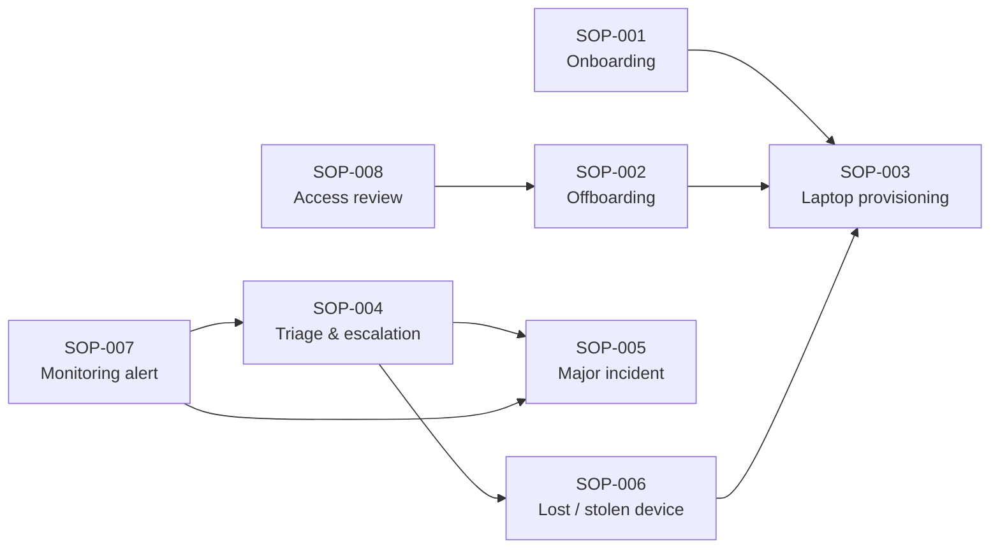

# Standard Operating Procedures (SOPs)

SOPs describe the **repeatable, controlled processes** of the Contoso Financial IT team (fictional):
who does what, in which order, with which approvals, and which evidence is kept. They are written so a
new Tier 1 or Tier 2 analyst can follow them without having to ask anyone.

## SOP or KB article?

| Use an **SOP** when… | Use a **KB article** when… |
|---|---|
| The work starts from a **request or a policy trigger** (new hire, termination, quarterly review, P1 declared, lost device) | The work starts from a **symptom** ("I'm locked out", "my S: drive is gone", "BitLocker recovery screen") |
| Several teams or approvals are involved and the order matters | One analyst can fix it by following troubleshooting steps |
| Evidence must be kept for audit (business controls BC-01 … BC-11) | The goal is fast, consistent resolution and ticket deflection |
| Example: [SOP-002 Employee offboarding](SOP-002-employee-offboarding.md) | Example: [KB0001 Account lockout](../knowledge-base/KB0001-account-lockout.md) |

SOPs link to KB articles for the technical steps. KB articles link back to an SOP when a process is
triggered (for example, a lost phone in [KB0017](../knowledge-base/KB0017-mobile-enrollment-email-lost-device.md) → SOP-006).

## Index

| ID | Title | Owner group | Trigger | Related controls |
|---|---|---|---|---|
| [SOP-001](SOP-001-new-hire-onboarding.md) | New hire onboarding | Contoso Identity & Access | HR new-hire request (RITM) approved by the hiring manager | BC-01, BC-03, BC-04, BC-09, BC-11 |
| [SOP-002](SOP-002-employee-offboarding.md) | Employee offboarding | Contoso Identity & Access | HR termination request (planned) or verified HR/Security call (immediate) | BC-02, BC-05, BC-06, BC-11 |
| [SOP-003](SOP-003-laptop-provisioning-refresh.md) | Laptop provisioning, refresh & retirement | Contoso Desktop Support | New hire, 48-month refresh, replacement, reimage, device return | BC-02, BC-03, BC-07, BC-09, BC-10, BC-11 |
| [SOP-004](SOP-004-incident-triage-escalation.md) | Incident intake, triage & escalation | Contoso Service Desk | Any contact that reports a disruption | BC-01, BC-07, BC-10 |
| [SOP-005](SOP-005-major-incident-communications.md) | Major incident (P1) management & communications | Contoso Service Desk (Major Incident Manager) | P1 declared or suspected | BC-07, BC-10 |
| [SOP-006](SOP-006-lost-stolen-device.md) | Lost or stolen device | Contoso Desktop Support | A user reports a lost or stolen laptop or phone | BC-02, BC-03, BC-05, BC-11 |
| [SOP-007](SOP-007-monitoring-alert-response.md) | Monitoring alert response | Contoso Infrastructure Ops | Zabbix problem or automatically created ServiceNow incident | BC-07, BC-09, BC-10 |
| [SOP-008](SOP-008-quarterly-access-review.md) | Quarterly access review | Contoso Identity & Access | First business day of January, April, July and October | BC-01, BC-04, BC-05, BC-06 |

## How the SOPs connect

## Conventions

- **Structure** (see [docs/01-lab-design.md §13](../docs/01-lab-design.md)): Purpose → Scope → Roles (RACI) →
  Prerequisites → Procedure → Controls & evidence → SLA/OLA → Exceptions → Related documents → Revision history.
- **RACI:** R = Responsible (does the work), A = Accountable (exactly one per activity, signs off),
  C = Consulted, I = Informed.
- **Record numbers** follow ServiceNow style: `INC00#####`, `RITM00#####`, `SCTASK00#####` (catalog task),
  `PRB00#####`, `CHG00#####`.
- **Scripts:** PowerShell commands are run from `scripts\powershell\` in an elevated Windows PowerShell 5.1
  session (for example `.\helpdesk\New-Employee.ps1`). Every script that changes state supports `-WhatIf`.
  **Always dry-run first.**
- **Lab vs. production:** steps marked **(production)** describe what an enterprise does with platforms this
  lab does not include (Microsoft 365, Intune, Apple Business Manager, a VPN concentrator).
- **Changing an SOP:** the owner group reviews the proposed edit, the IT Manager approves it, and a row is
  added to *Revision history*. An SOP that has not been reviewed in 12 months is flagged in the knowledge
  review ([itil/knowledge-management.md](../itil/knowledge-management.md)).
