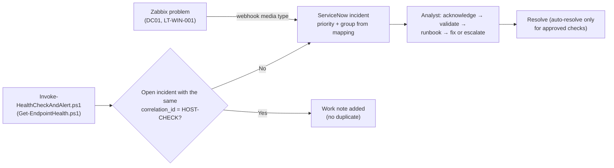

# SOP-007 · Monitoring Alert Response

| Field | Value |
|---|---|
| SOP ID | SOP-007 |
| Owner | Contoso Infrastructure Ops (monitoring platform owner) |
| Approver | IT Manager (Lucas Moreno) |
| Version / effective date | 1.0 · 2026-11-10 |
| Review cycle | Every 6 months, together with the alert-noise review |
| Related controls | BC-07, BC-09, BC-10 |

## 1. Purpose

Turn monitoring signals into fast, verified action. Acknowledge within the SLA, rule out false positives,
fix or escalate with a runbook, and keep alerts **actionable** by tuning noise through change control
instead of ignoring it.

## 2. Scope

- **Zabbix 7.0 LTS** on MON01: agent 2 on DC01 and LT-WIN-001 (template *Windows by Zabbix agent active*),
  plus the DC01 service checks (DNS TCP 53, LDAP 389, Kerberos 88, SMB 445, DHCPServer service). Problems
  become ServiceNow incidents through the webhook media type.
- **Endpoint health checks:** `Invoke-HealthCheckAndAlert.ps1` runs `Get-EndpointHealth.ps1` as a
  scheduled task and creates incidents through the ServiceNow Table API.



## 3. Roles (RACI)

| Activity | Infrastructure Ops | Desktop Support | Network Operations | Service Desk | Change Manager |
|---|---|---|---|---|---|
| Server alerts (DC01, MON01): acknowledge, fix, escalate | R/A | – | C | I | – |
| Endpoint alerts (health check, Zabbix on laptops) | C | R/A | – | I | – |
| Network-related alerts (DNS, DHCP reachability) | R | – | R/A | I | – |
| Watch the dashboard during business hours; spot user impact | I | I | I | R | – |
| Trigger/threshold tuning, maintenance windows | R/A | C | C | I | A (approves the change) |

## 4. Prerequisites

- Zabbix web access (`http://zabbix.corp.contoso.internal`) and a ServiceNow list view filtered to
  incidents where *Correlation ID* is not empty.
- KB runbooks (table in step 6) and scripts in `scripts\powershell\` on the technician workstation.
- Alert → incident mapping (from [docs/01-lab-design.md §9](../docs/01-lab-design.md)):

  | Source severity | Impact × Urgency | Priority | Assignment group |
  |---|---|---|---|
  | Zabbix *Disaster* (server) | 1 × 1 | P1 → also [SOP-005](SOP-005-major-incident-communications.md) | Contoso Infrastructure Ops |
  | Zabbix *High* (server) | 2 × 1 | P2 | Contoso Infrastructure Ops |
  | Zabbix *Average* (server) | 2 × 2 | P3 | Contoso Infrastructure Ops |
  | Zabbix *Warning* (any) | 3 × 2 | P4 | Owning group |
  | Endpoint health *Critical* | 3 × 1 | P3 | Contoso Desktop Support |
  | Endpoint health *Warning* | 3 × 2 | P4 | Contoso Desktop Support |

## 5. Procedure

1. **Detect.** The incident is created automatically. Its short description comes from the alert and it
   carries `correlation_id = <HOST>-<CHECK>`. Examples:
   - **INC0010020** "DC01 – DHCP Server service not running" (Zabbix *High* → **P2**, Infrastructure Ops)
   - a LT-WIN-001 C: drive below 10% free (endpoint *Critical* → **P3**, Desktop Support)
2. **Acknowledge** within the response target of the priority (P1 15 min · P2 30 min · P3 2 h · P4 8 h).
   - In ServiceNow: assign the incident to yourself and set it to *In Progress*.
   - In Zabbix: open *Monitoring → Problems*, select *Update*, tick *Acknowledge* and add the INC number,
     so nobody works the same problem twice.
3. **Correlate.** De-duplication is per `correlation_id` only. Check for related alerts that share one
   root cause, for example DNS, LDAP and Kerberos all failing on DC01 at once. Make one parent incident
   and link the others as children. If the alerts point to a P1, go to SOP-005.
4. **Validate.** Is it real?
   - Endpoint:
     ```powershell
     .\endpoint\Get-EndpointHealth.ps1 -Format Console; $LASTEXITCODE    # 0 OK / 1 Warning / 2 Critical
     .\endpoint\Invoke-NetworkTriage.ps1 -InternalHost dc01.corp.contoso.internal
     ```
   - DC01 services and ports:
     ```powershell
     Get-Service DHCPServer, DNS, NTDS, Netlogon, Kdc | Select-Object Name, Status
     Test-NetConnection dc01.corp.contoso.internal -Port 389
     Resolve-DnsName dc01.corp.contoso.internal -Server 10.10.10.10
     dcdiag /test:services
     ```
   - **False positive?** Record the evidence and resolve as a monitoring false positive. Then follow step 9
     (alert hygiene). Never silence the alert without a record.
5. **Assess user impact and re-prioritize if needed.** For example, if the DHCP service is down,
   existing leases (8 days) still work but new or rebooted devices fail. Raise the impact if users are
   already calling. Check with the Service Desk.
6. **Use the runbook:**

   | Alert | First runbook |
   |---|---|
   | C: free space low · slow device | [KB0013](../knowledge-base/KB0013-low-disk-space-slow-performance.md) + `Invoke-EndpointRemediation.ps1 -Action DiskCleanup` |
   | DHCP service/scope · clients on 169.254.x.x | [KB0005](../knowledge-base/KB0005-no-network-apipa-dhcp.md) |
   | DNS port/resolution failures | [KB0004](../knowledge-base/KB0004-dns-resolution-failure.md) |
   | Kerberos/time skew symptoms | [KB0010](../knowledge-base/KB0010-kerberos-clock-skew.md) + `-Action SyncTime` |
   | Print spooler stopped | [KB0012](../knowledge-base/KB0012-print-queue-stuck.md) + `-Action RestartSpooler` |
   | Defender real-time protection off · firewall profile off | Treat as a **security** event: restore through GPO, then investigate why it turned off ([SOP-004](SOP-004-incident-triage-escalation.md) security exception) |

7. **Fix within your rights, or escalate** with the SOP-004 handoff checklist. Restarting a stopped
   service to restore it is an operational action. A **configuration** change on a server needs a change
   record, or an emergency change during a P1 (BC-07).
8. **Recover and resolve:**
   - Zabbix recovery events update the incident through the webhook.
   - The endpoint script adds a work note when a check passes again.
   - With `-AutoResolve`, only the checks marked *Yes* below may close themselves. Everything else is
     resolved by an analyst who writes down the cause.

   | Check | Auto-resolve allowed? | Why |
   |---|---|---|
   | Memory in use · uptime · pending reboot | Yes | Transient, or cleared by the patch reboot |
   | C: free space | No | Needs a known cause; repeats feed problem management |
   | Automatic services stopped · System log errors | No | The cause must be reviewed first |
   | Defender RTP / signatures · firewall profile | **Never** | Security controls (BC-09) |

9. **Keep alerts clean (alert hygiene).** A trigger is *noisy* if it gives ≥ 3 false positives in 30 days
   or flaps more than 5 times a day.
   - Propose the threshold or trigger change as a **normal change** with the evidence
     ([itil/change-management.md](../itil/change-management.md)).
   - Never disable a trigger without a change.
   - For planned work, create a Zabbix maintenance window first (*Data collection → Maintenance*) and
     link the CHG.
10. **Link to a problem.** If the same `correlation_id` produces 3 or more incidents in 7 days, or one
    alert keeps coming back after being fixed, open or link a problem record
    ([itil/problem-management.md](../itil/problem-management.md)).
11. **Close.** Write the work note (*Issue → Steps taken → Result → Next action*), link the KB, and update
    the runbook if you learned something new.

## 6. Controls & evidence

| Control | Evidence |
|---|---|
| BC-10 Logging & monitoring | Zabbix problem history with acknowledgment messages; incident with correlation ID and timeline |
| BC-09 Endpoint security baseline | Firewall/Defender alerts are never auto-resolved; restoration is documented |
| BC-07 Change control | CHG for every trigger, threshold or maintenance-window change |

## 7. SLA / OLA

| Item | Target |
|---|---|
| Acknowledge (ServiceNow + Zabbix) | Response target of the priority: P1 15 min · P2 30 min · P3 2 h · P4 8 h |
| Resolve | P1 4 h · P2 8 h · P3 24 h · P4 72 h |
| False-positive tuning change raised | ≤ 5 business days after the noise threshold is reached |
| Maintenance window created | Before planned work starts (no exceptions) |

## 8. Exceptions

| Situation | Handling |
|---|---|
| MON01 itself is down ("who monitors the monitor") | Infrastructure Ops opens a P2. Run `./linux_health_check.sh` on MON01 (Docker containers, disk, time). Tell the Service Desk that alerting is degraded and do manual checks of DC01 every hour until it is restored. |
| Alert storm (≥ 10 alerts from one host in 5 minutes) | One parent incident; check the host and network first. Possible P1 → SOP-005. |
| ServiceNow integration failure (no incidents created) | Work from the Zabbix *Problems* view and create incidents by hand. Infrastructure Ops checks the integration credential and webhook log. |
| Planned maintenance not in Zabbix | Acknowledge the alerts with the CHG number. Report the missing maintenance window as a change-process gap. |

## 9. Related documents

- [docs/04-monitoring-alerting.md](../docs/04-monitoring-alerting.md) · [docs/06-lab-scenarios.md](../docs/06-lab-scenarios.md) (`DhcpServiceDown`, `DiskFull`)
- [SOP-004 Incident triage & escalation](SOP-004-incident-triage-escalation.md) · [SOP-005 Major incident](SOP-005-major-incident-communications.md)
- [itil/incident-management.md](../itil/incident-management.md) · [itil/problem-management.md](../itil/problem-management.md) ·
  [itil/change-management.md](../itil/change-management.md)
- Scripts: [`Invoke-HealthCheckAndAlert.ps1`](../scripts/powershell/integration/Invoke-HealthCheckAndAlert.ps1),
  [`Get-EndpointHealth.ps1`](../scripts/powershell/endpoint/Get-EndpointHealth.ps1),
  [`linux_health_check.sh`](../scripts/bash/linux_health_check.sh)

## 10. Revision history

| Version | Date | Author | Change |
|---|---|---|---|
| 0.9 | 2026-11-03 | Contoso Infrastructure Ops | Draft for review |
| 1.0 | 2026-11-10 | Contoso Infrastructure Ops | Approved by IT Manager; auto-resolve rules and alert hygiene added |
